```{r}
#| label: setup-directorio
#| include: false
knitr::opts_knit$set(root.dir = normalizePath(".."))
```

```{r}
#| label: setup-ejecucion
#| include: false
salida <- capture.output(source("analisis/correr-todo.R", encoding = "UTF-8"))
```

```{r}
#| label: setup-formato
#| include: false
f <- function(x, d = 2) formatC(x, digits = d, format = "f", big.mark = ",")
vp <- function(p) if (p < 1e-4) "$< 0.0001$" else paste0("$= ", formatC(p, digits = 4, format = "f"), "$")
dec <- function(p) if (p < 0.05) "Se rechaza $H_0$ al 5 %." else "No se rechaza $H_0$ al 5 %."
fila <- function(k, nombre, col) {
  tb <- resultados[[k]]$transformacion$tabla
  tb[[col]][tb$transformacion == nombre]
}
dep <- function(k) resultados[[k]]$dependencia
lineas <- function(patron) cat(grep(patron, salida, value = TRUE), sep = "\n")
mejor_om <- function(k, h) {
  tabla_origen_movil |>
    filter(serie == k, horizonte == h) |>
    arrange(RMSE) |>
    slice(1)
}
vg <- function(tabla, k, columna) tabla[[columna]][tabla$serie == k][1]
```

# 1. Estructura del repositorio

El repositorio `st-2026-2-trabajo1-STGFBL` tiene la estructura exigida. Las funciones viven en `R/`, organizadas por tema, y `analisis/correr-todo.R` las carga, analiza las tres series en orden, guarda las figuras en `figs/` y deja todos los resultados en la lista `resultados`. Este informe ejecuta ese script al renderizarse y toma de allí cada cifra, de modo que el texto coincide siempre con la ejecución.

| Archivo | Funciones |
|:---|:---|
| `R/00-lectura.R` | `leer_serie()`, `ficha_serie()` |
| `R/01-graficos.R` | `graficar_serie()`, `grafico_estacional()`, `grafico_rezagos()`, `correlograma()`, `descomposicion_clasica()` |
| `R/02-operadores.R` | `diferenciar()`, `polinomio_rezago()`, `coef_diferencia()` |
| `R/03-dependencia.R` | `acf_muestral()`, `pacf_dl()`, `ljung_box()`, `varianza_largo_plazo()` |
| `R/04-metodos.R` | Los métodos de pronóstico de la sección 6 |
| `R/05-evaluacion.R` | `particion_serie()` y las funciones de evaluación de la sección 6 |

# 2. Las tres series y la pregunta de pronóstico

## 2(a) Fichas verificadas con código

```{r}
#| label: tabla-fichas
#| echo: true
knitr::kable(
  tabla_fichas,
  col.names = c("Nombre", "Unidad", "Frecuencia", "Fecha inicial", "Fecha final", "T", "Mínimo", "Máximo", "Media"),
  digits = 2
)
```

La ficha sale de `leer_serie()`, que además verifica que las fechas de cada archivo son crecientes y equiespaciadas según su frecuencia y se detiene si no lo son. Las tres series pasaron esa verificación, y sus cifras coinciden con las del `LEEME.md`.

## 2(b) Pregunta, decisión y horizonte

**Serie 1, demanda mensual.** *Pregunta:* ¿cuántos GWh debe contratar la gerencia comercial para cada mes de 2026? *Decisión:* el volumen de los doce contratos que se firman en diciembre de 2025; la energía que falte se paga en bolsa con un sobrecosto del 35 % y la que sobre se liquida con una pérdida del 20 %. *Horizonte:* $H = 12$ meses, de enero a diciembre de 2026.

**Serie 2, consumo diario de la estación El Guamo.** *Pregunta:* ¿cuántos MWh debe contratar la mesa de compras para cada día de la semana siguiente? *Decisión:* el volumen contratado cada lunes a 420 pesos por kWh; el faltante se compra a 780 pesos por kWh y el sobrante se revende a 250. *Horizonte:* $H = 7$ días.

**Serie 3, usuarios conectados.** *Pregunta:* ¿superarán los usuarios los 450 mil antes de que un transformador ordenado en los próximos doce meses pueda entrar en servicio? *Decisión:* si se ordena el transformador, de 6.800 millones de pesos, y en qué mes. *Horizonte:* $H = 21$ meses. Un transformador ordenado en el mes 12 entra en servicio en el mes $12 + 9 = 21$; para saber si hace falta ordenarlo dentro del año hay que pronosticar hasta ese mes, y un horizonte de 12 meses no detectaría una sobrecarga entre los meses 13 y 21 que ya exigiría la orden.

## 2(c) Partición en tramos y orígenes

Con $n_0 = \lfloor 0.8\,T \rfloor$, el tramo de estimación son las observaciones $1, \ldots, n_0$. Los orígenes de la evaluación son $o = n_0, \ldots, T-1$ para $h = 1$ y $o = n_0, \ldots, T-H$ para el horizonte $H$.

```{r}
#| label: tabla-particion
#| echo: true
knitr::kable(
  tabla_particion[, c("serie", "T", "n0", "H", "n_origenes_h1", "n_origenes_H",
                      "estimacion", "validacion", "origenes_h1", "origenes_H")],
  col.names = c("Serie", "T", "$n_0$", "H", "Orígenes h = 1", "Orígenes H",
                "Tramo de estimación", "Tramo de validación", "Fechas de los orígenes h = 1",
                "Fechas de los orígenes H")
)
```

# 3. Descripción y patrón

## Serie 1: demanda mensual de energía

### 3(a) Gráfico en el tiempo y gráfico de rezagos

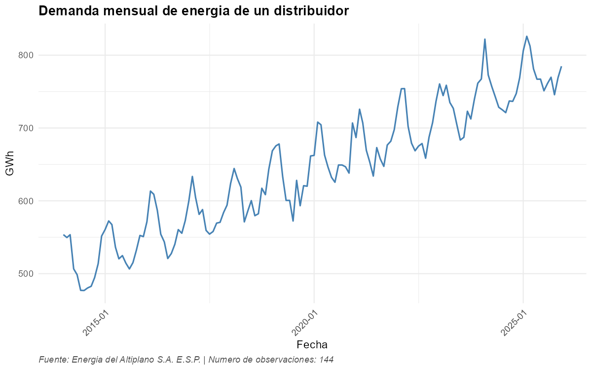{width=85%}

La demanda crece de forma sostenida, de unos 550 GWh en 2014 a cerca de 790 GWh en 2025, casi en línea recta. Sobre esa tendencia se repite cada año el mismo patrón: un pico en febrero, un valle a mitad de año y una subida hacia diciembre.

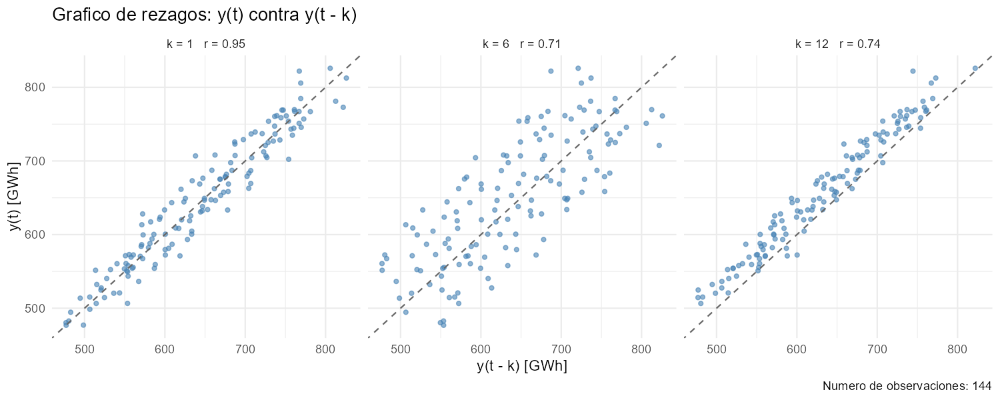{width=95%}

Se eligen los rezagos 1, 6 y 12 porque cada uno responde una pregunta distinta. En $k = 1$ ($r_1 =$ `r f(resultados$serie1$acf_serie[1])`) la nube es estrecha sobre la diagonal: cada mes se parece mucho al anterior. En $k = 6$ ($r_6 =$ `r f(resultados$serie1$acf_serie[6])`), medio ciclo, la nube se dispersa, porque se enfrentan meses de fases opuestas, como febrero contra agosto. En $k = 12$ ($r_{12} =$ `r f(resultados$serie1$acf_serie[12])`) la nube vuelve a cerrarse y queda paralela por encima de la diagonal: el mismo mes un año después es mayor por una cantidad casi constante, que es la huella conjunta de la estacionalidad anual y de la tendencia lineal.

### 3(b) Estacionalidad

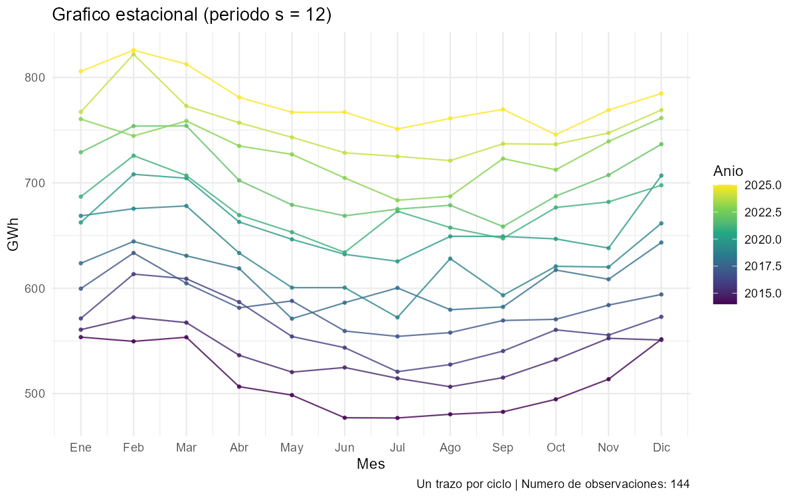{width=85%}

Los doce trazos tienen la misma forma y se desplazan hacia arriba de manera casi paralela. **La serie tiene estacionalidad de período $s = 12$.**

Para elegir entre la descomposición aditiva y la multiplicativa se compara, en cada año completo, la media con la desviación estándar. En la versión aditiva la amplitud estacional no depende del nivel; en la multiplicativa crece con él.

```{r}
#| label: s1-evidencia
#| echo: true
ev1 <- resultados$serie1$estacionalidad$evidencia
knitr::kable(ev1$tabla, col.names = c("Año", "Media (GWh)", "Desviación (GWh)", "Rango (GWh)"), digits = 2)
```

La correlación entre la media y la desviación de cada año es `r f(ev1$correlacion_media_desviacion, 3)`, y la pendiente de la desviación sobre la media es `r f(ev1$pendiente_desviacion_sobre_media, 5)`: a lo largo de los `r f(max(ev1$tabla$media) - min(ev1$tabla$media), 0)` GWh que sube la media anual, la desviación cambiaría apenas `r f(ev1$pendiente_desviacion_sobre_media * (max(ev1$tabla$media) - min(ev1$tabla$media)), 2)` GWh. La desviación se mantiene entre `r f(min(ev1$tabla$desviacion), 0)` y `r f(max(ev1$tabla$desviacion), 0)` GWh sin tendencia, mientras que el coeficiente de variación baja de `r f(100 * ev1$cv_por_ciclo[1], 1)` % a `r f(100 * ev1$cv_por_ciclo[length(ev1$cv_por_ciclo)], 1)` %. Si la estacionalidad fuera multiplicativa, lo constante sería el coeficiente de variación y no la desviación. **Se elige la descomposición aditiva.**

La descomposición clásica se programó a mano en `descomposicion_clasica()`: la tendencia es una media móvil centrada $2 \times 12$, los índices estacionales son el promedio por mes de la serie sin tendencia, normalizados para que sumen cero, y el residuo es lo que queda.

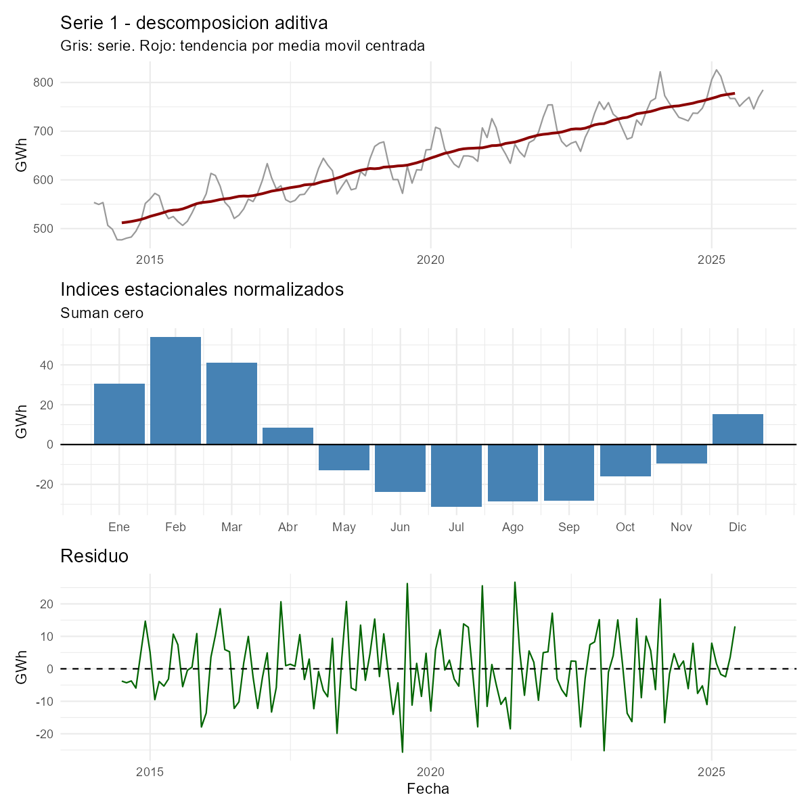{width=85%}

```{r}
#| label: s1-indices
#| echo: true
knitr::kable(resultados$serie1$estacionalidad$aditiva$indices[, c("etiqueta", "indice")],
             col.names = c("Mes", "Índice estacional (GWh)"), digits = 2)
```

```{r}
#| label: s1-indices-cifras
idx1 <- resultados$serie1$estacionalidad$aditiva$indices
```

Febrero está `r f(max(idx1$indice), 1)` GWh por encima de la tendencia y julio `r f(abs(min(idx1$indice)), 1)` GWh por debajo; la oscilación de pico a valle es de `r f(max(idx1$indice) - min(idx1$indice), 1)` GWh cada año. El residuo oscila en una banda estable alrededor de cero, sin tendencia y sin abrirse cuando el nivel sube. La versión multiplicativa, que se muestra para comparar, deja un residuo de forma parecida porque la oscilación estacional es pequeña frente al nivel; entre las dos decide la evidencia numérica anterior.

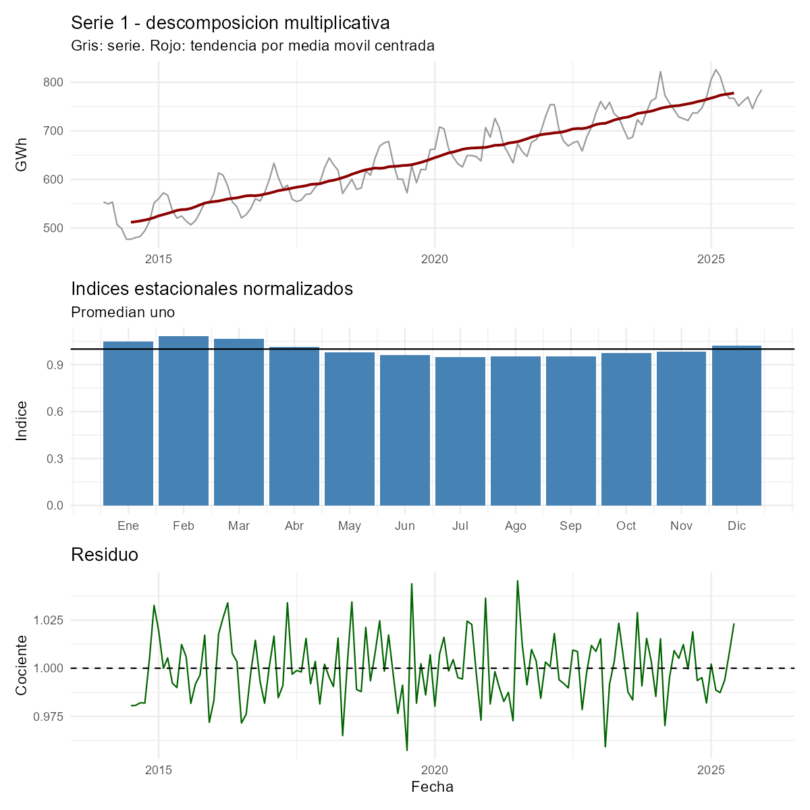{width=85%}

### 3(c) Correlograma y clasificación del patrón

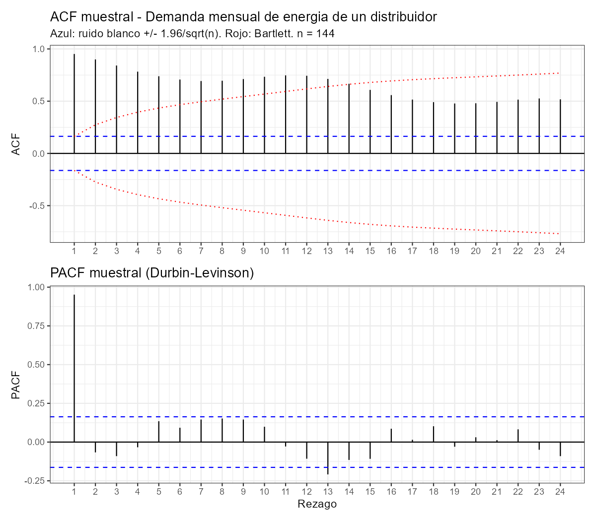{width=85%}

Con $m = \min\{\lfloor 144/4 \rfloor, 24\} = 24$, la ACF decae muy despacio desde `r f(resultados$serie1$acf_serie[1])` y repunta en los rezagos 12 y 24; la PACF tiene un único pico grande en el rezago 1. El decaimiento lento es la forma de una serie con tendencia, y los repuntes en 12 y 24 son la onda estacional superpuesta. **Patrón: tendencia lineal más estacionalidad aditiva de período 12; la serie no es estacionaria en media.**

## Serie 2: consumo diario de la estación El Guamo

### 3(a) Gráfico en el tiempo y gráfico de rezagos

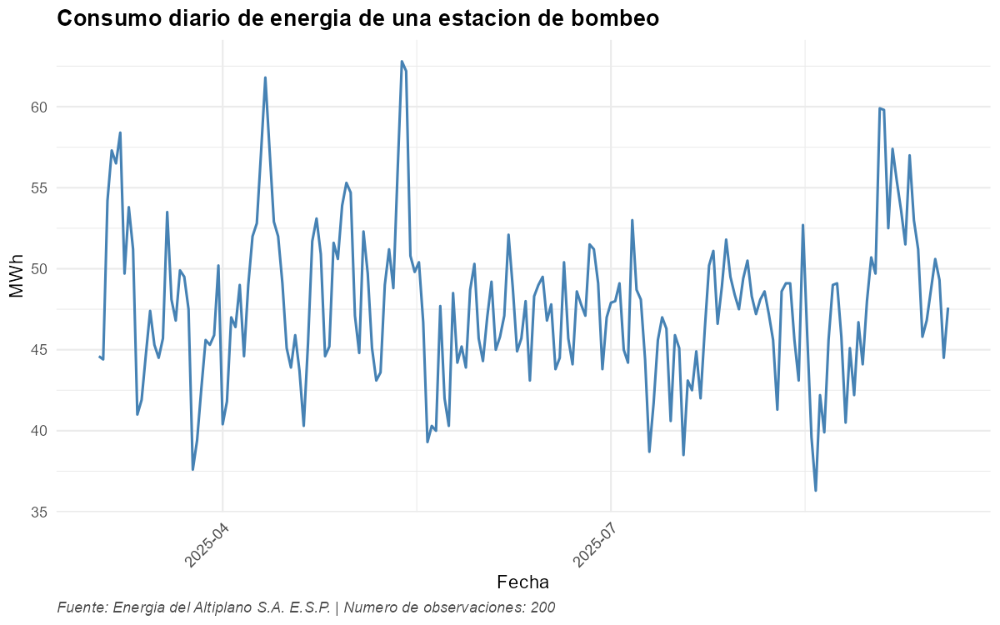{width=85%}

La serie no tiene tendencia: oscila alrededor de 47 a 48 MWh, con rachas de varios días de consumo alto, como a mediados de abril, de mayo y a inicios de septiembre, y otras de consumo bajo.

{width=95%}

Se eligen los rezagos 1, 2 y 7. En $k = 1$ ($r_1 =$ `r f(resultados$serie2$acf_serie[1])`) la nube es alargada: un día de consumo alto suele seguirse de otro alto. En $k = 2$ ($r_2 =$ `r f(resultados$serie2$acf_serie[2])`) la relación se debilita. En $k = 7$ ($r_7 =$ `r f(resultados$serie2$acf_serie[7])`), el mismo día de la semana anterior, la nube es redonda: no hay relación semanal.

### 3(b) Estacionalidad

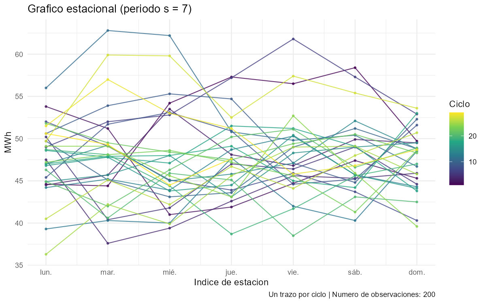{width=85%}

Como los datos son diarios y la compra es semanal, se examina el período $s = 7$. Los trazos de cada semana se cruzan sin una forma común: ningún día está sistemáticamente arriba o abajo.

```{r}
#| label: s2-evidencia
#| echo: true
est2 <- resultados$serie2$estacionalidad
knitr::kable(
  data.frame(dia = weekdays(resultados$serie2$datos$fecha[1:7]), media = as.numeric(est2$media_por_dia)),
  col.names = c("Día", "Consumo medio (MWh)"), digits = 2
)
```

Las medias por día de la semana van de `r f(min(est2$media_por_dia))` a `r f(max(est2$media_por_dia))` MWh: la diferencia entre el día más alto y el más bajo, `r f(est2$rango_medias)` MWh, es apenas el `r f(100 * est2$rango_medias / est2$desviacion_serie, 0)` % de la desviación de la serie (`r f(est2$desviacion_serie)` MWh), y $r_7 =$ `r f(resultados$serie2$acf_serie[7])` y $r_{14} =$ `r f(resultados$serie2$acf_serie[14])` quedan dentro de la banda de ruido blanco. Saber qué día es no cambia el consumo esperado. **La serie no tiene estacionalidad.**

### 3(c) Correlograma y clasificación del patrón

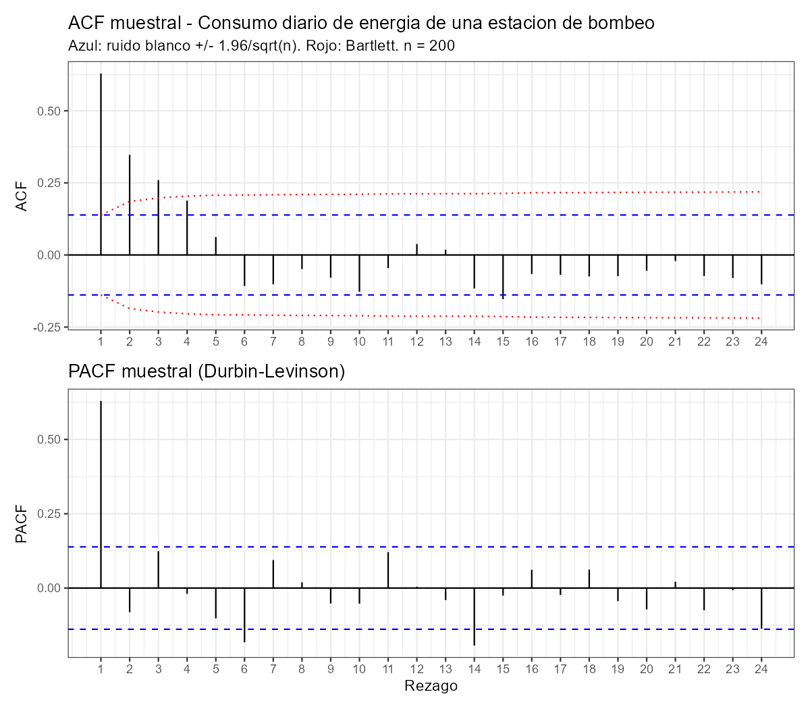{width=85%}

Con $m = 24$, la ACF decae rápido (`r paste(f(resultados$serie2$acf_serie[1:4]), collapse = ", ")`) y se apaga desde el rezago 5, sin picos en 7, 14 ni 21. La PACF tiene un único pico grande en el rezago 1. **Patrón: nivel constante sin tendencia ni estacionalidad, con dependencia de corto plazo; la serie es plausiblemente estacionaria.**

## Serie 3: usuarios conectados a la red

### 3(a) Gráfico en el tiempo y gráfico de rezagos

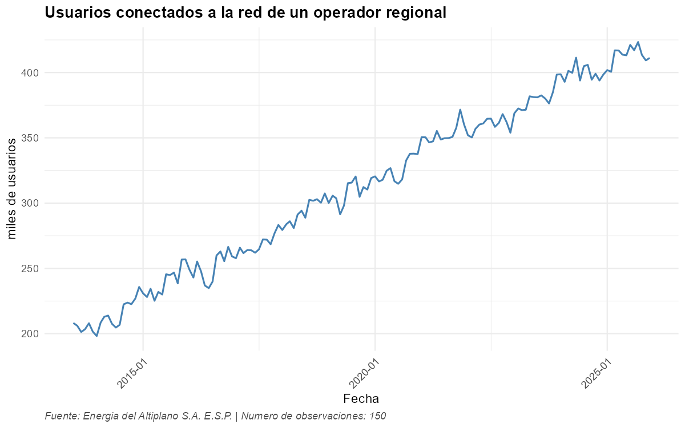{width=85%}

El número de usuarios crece de forma casi lineal, de unos 208 mil a 411 mil, con pequeños saltos pero sin un patrón que se repita cada año.

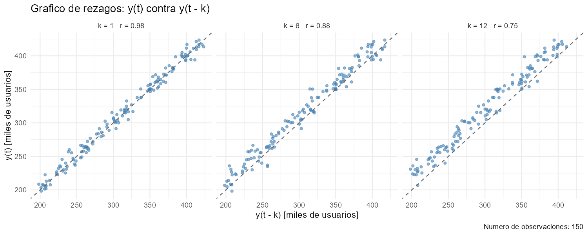{width=95%}

Se eligen los rezagos 1, 6 y 12, los mismos de la serie 1, para contrastar. Aquí la correlación decae de forma monótona: $r_1 =$ `r f(resultados$serie3$acf_serie[1])`, $r_6 =$ `r f(resultados$serie3$acf_serie[6])` y $r_{12} =$ `r f(resultados$serie3$acf_serie[12])`. La nube de $k = 12$ no es más estrecha que la de $k = 6$, como ocurriría si hubiera estacionalidad anual; solo se aleja más de la diagonal, por el crecimiento acumulado.

### 3(b) Estacionalidad

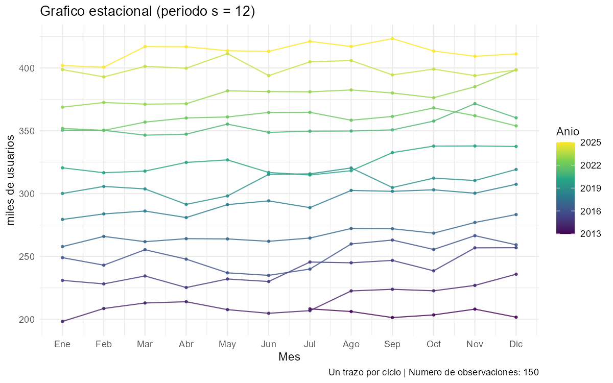{width=85%}

Los trazos anuales son casi planos y no comparten forma; solo se desplazan hacia arriba. Para medirlo se aplicó la descomposición clásica aditiva y se compararon los índices estacionales con el ruido.

```{r}
#| label: s3-evidencia
#| echo: true
est3 <- resultados$serie3$estacionalidad
knitr::kable(est3$descomposicion$indices[, c("etiqueta", "indice")],
             col.names = c("Mes", "Índice (miles de usuarios)"), digits = 2)
```

Los índices suben y bajan sin orden, y su amplitud total, `r f(est3$amplitud_indices)` mil usuarios, es menor que la desviación del residuo, `r f(est3$desviacion_residuo)` mil. Lo que la descomposición atribuye a la estación no se distingue del ruido. **La serie no tiene estacionalidad.**

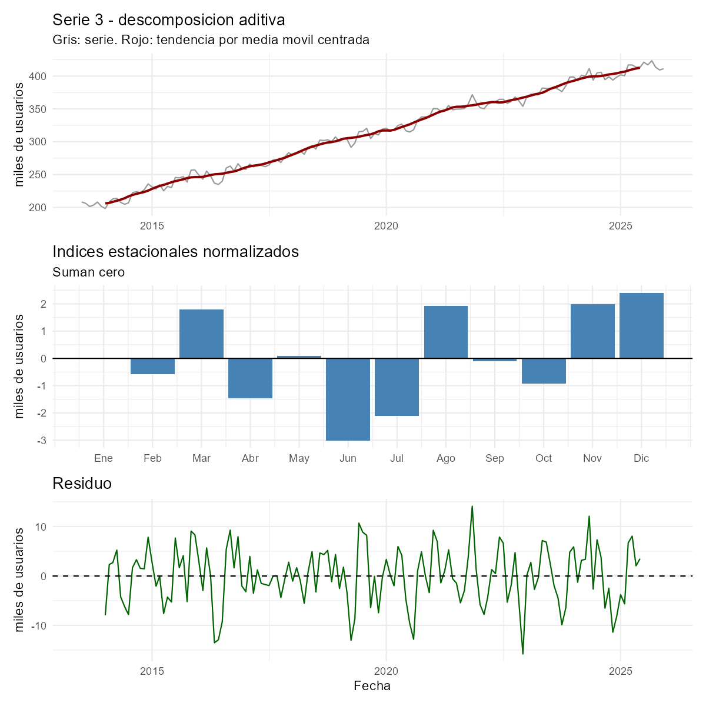{width=85%}

### 3(c) Correlograma y clasificación del patrón

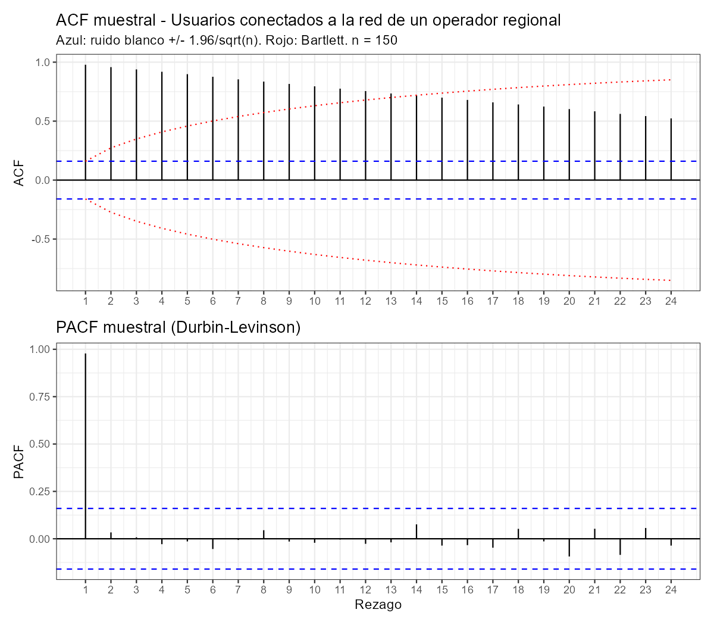{width=85%}

Con $m = 24$, la ACF decae de forma lenta y casi lineal, de `r f(resultados$serie3$acf_serie[1])` a `r f(resultados$serie3$acf_serie[24])`, sin ningún repunte en 12 ni en 24, a diferencia de la serie 1. La PACF tiene un único pico en el rezago 1. **Patrón: tendencia creciente sin estacionalidad; la serie no es estacionaria en media.**

# 4. Operador de rezago

## 4(a) Funciones y verificación

`diferenciar(y, d, D, s)` aplica $(1-B)^d(1-B^s)^D$ restando a cada valor el de $s$ períodos antes, $D$ veces, y luego el del período anterior, $d$ veces, sin usar `diff()`. `polinomio_rezago(coef)` recibe $c_1, \ldots, c_p$ de $c(B) = 1 + c_1 B + \cdots + c_p B^p$ y devuelve sus raíces con su parte real, su parte imaginaria, su módulo, su argumento y el período $2\pi/|\arg z|$ que les corresponde. La verificación contra `diff()` da diferencia cero en los tres casos:

```{r}
#| label: verif-diferenciar
#| comment: ""
lineas("diferenciar\\(")
```

## 4(b) Transformaciones candidatas y sus raíces

El diagnóstico de la sección 3 sugiere las candidatas de cada serie. No se proponen transformaciones previas de escala: en la serie 1 la evidencia favorece la versión aditiva, de modo que el logaritmo no es necesario, y las series 2 y 3 no muestran una varianza que crezca con el nivel.

Cada factor elimina un componente determinista distinto:

- **$(1-B)$**, con raíz $z = 1$, elimina un nivel y convierte una tendencia lineal $\beta_0 + \beta_1 t$ en la constante $\beta_1$.
- **$(1-B)^2$**, con raíz $z = 1$ doble, elimina una tendencia lineal por completo y convierte una cuadrática en constante.
- **$(1-B^{12})$** tiene las doce raíces de la unidad $e^{2\pi i k/12}$, $k = 0, \ldots, 11$, todas de módulo 1. La raíz $z = 1$ convierte la tendencia lineal en la constante $12\beta_1$, y las otras once eliminan cualquier patrón que se repita cada 12 meses, con períodos de 12, 6, 4, 3, 2.4 y 2 meses.
- **$(1-B)(1-B^{12})$** junta ambas: $z = 1$ doble, más las once raíces estacionales.

```{r}
#| label: polinomios
#| echo: true
pol <- bind_rows(lapply(names(resultados), function(k) {
  tb <- resultados[[k]]$transformacion$tabla[-1, c("transformacion", "polinomio")]
  bind_cols(tibble(serie = k), tb)
}))
knitr::kable(pol, col.names = c("Serie", "Transformación", "Polinomio en B"))
```

**Serie 1.** Candidatas $(1-B)$, por la tendencia; $(1-B^{12})$, por la estacionalidad; y $(1-B)(1-B^{12})$, por las dos.

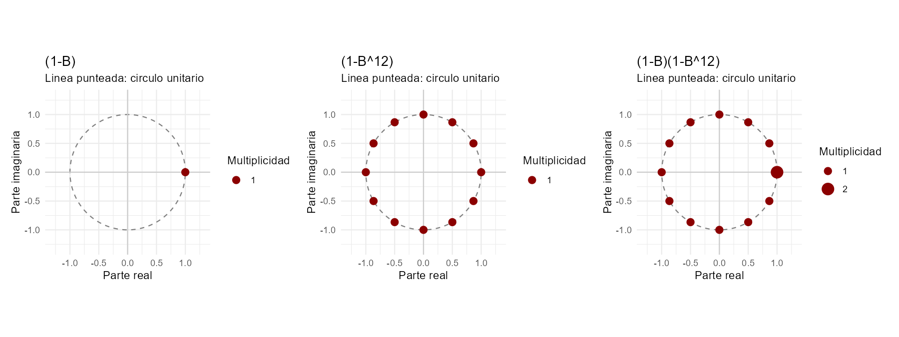{width=100%}

**Serie 2.** La serie no muestra tendencia ni estacionalidad, así que la candidata principal es no transformar. Se incluyen $(1-B)$ y $(1-B)^2$ para comprobar que serían diferencias de más.

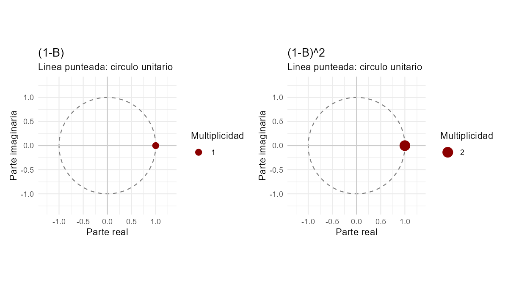{width=75%}

**Serie 3.** Candidatas $(1-B)$, por la tendencia; $(1-B)^2$, para descartar una tendencia cuadrática; y $(1-B^{12})$, para descartar estacionalidad.

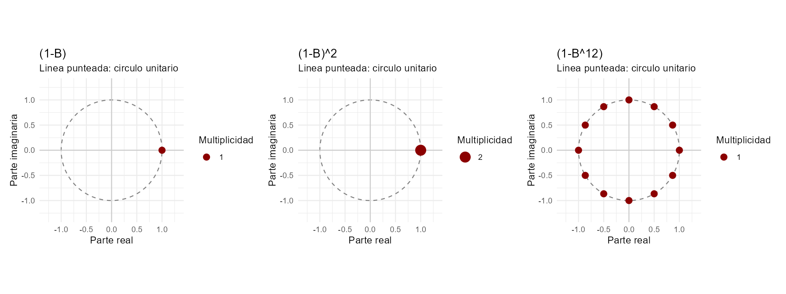{width=100%}

## 4(c) Elección de la transformación

En cada tabla, la varianza es $\hat\gamma(0)$ con divisor $n$, y la columna *Identidad* es la varianza que predice $\text{Var}(\nabla X_t) = 2\gamma(0) - 2\gamma(1) = 2\gamma(0)(1 - \rho_1)$ a partir de la serie a la que se le aplica la última diferencia. La identidad solo vale si esa serie es estacionaria, así que también sirve como diagnóstico.

```{r}
#| label: tablas-transformaciones
#| echo: true
#| results: asis
for (k in names(resultados)) {
  cat("\n**", resultados[[k]]$ficha$nombre, "**\n\n", sep = "")
  tb <- resultados[[k]]$transformacion$tabla
  print(knitr::kable(
    tb[, c("transformacion", "n", "varianza", "r1", "varianza_identidad", "media", "media_esperada")],
    col.names = c("Transformación", "n", "Varianza", "$r_1$", "Identidad", "Media", "Media esperada"),
    digits = 3
  ))
  cat("\n")
}
```

**Serie 1: se elige $(1-B^{12})$.** Es la candidata de menor varianza, `r f(fila("serie1", "(1-B^12)", "varianza"), 1)`, y deja $r_1 =$ `r f(fila("serie1", "(1-B^12)", "r1"), 3)`, sin dependencia de un mes al siguiente. $(1-B)$ sola deja una varianza de `r f(fila("serie1", "(1-B)", "varianza"), 1)` porque no elimina la estacionalidad. Agregar $(1-B)$ sobre $(1-B^{12})$ es diferenciar de más: la varianza se duplica, a `r f(fila("serie1", "(1-B)(1-B^12)", "varianza"), 1)`, y $r_1$ cae a `r f(fila("serie1", "(1-B)(1-B^12)", "r1"), 3)`. Es la firma de diferenciar una serie que ya era estacionaria y casi sin correlación: si $\rho_1 = 0$, la identidad da $\text{Var}(\nabla X_t) = 2\gamma(0)$ y $\nabla X_t$ tiene $\rho_1 = -0.5$. La identidad lo confirma: predice `r f(fila("serie1", "(1-B)(1-B^12)", "varianza_identidad"), 1)` y se observa `r f(fila("serie1", "(1-B)(1-B^12)", "varianza"), 1)`. En cambio, al diferenciar la serie original la identidad falla (predice `r f(fila("serie1", "(1-B)", "varianza_identidad"), 1)` frente a `r f(fila("serie1", "(1-B)", "varianza"), 1)` observado), porque esa serie no es estacionaria.

*Verificación de la media.* $(1-B^{12})$ aplicada a $\beta_0 + \beta_1 t + S_t$ deja la constante $12\beta_1$. Con la pendiente por mínimos cuadrados, $\hat\beta_1 =$ `r f(resultados$serie1$transformacion$pendiente_mco, 3)` GWh por mes, se espera `r f(fila("serie1", "(1-B^12)", "media_esperada"))`, y la media observada es `r f(fila("serie1", "(1-B^12)", "media"))` GWh.

**Serie 2: no se transforma.** Esta serie muestra por qué una varianza menor no basta para diferenciar. $(1-B)$ baja la varianza de `r f(fila("serie2", "Ninguna", "varianza"))` a `r f(fila("serie2", "(1-B)", "varianza"))`, y la identidad explica por qué: $2(`r f(fila("serie2", "Ninguna", "varianza"))`)(1 - `r f(fila("serie2", "Ninguna", "r1"), 3)`) =$ `r f(fila("serie2", "(1-B)", "varianza_identidad"))`. Cuando $\rho_1 > 0.5$, diferenciar reduce la varianza aunque la serie ya sea estacionaria. Pero no hay nada que quitar: la pendiente por mínimos cuadrados es `r f(resultados$serie2$transformacion$pendiente_mco, 4)` MWh por día y la media de $\nabla Y_t$ es `r f(fila("serie2", "(1-B)", "media"), 3)`, ambas prácticamente cero. Al diferenciar, $r_1$ pasa de `r f(fila("serie2", "Ninguna", "r1"), 3)` a `r f(fila("serie2", "(1-B)", "r1"), 3)`, y con $(1-B)^2$ a `r f(fila("serie2", "(1-B)^2", "r1"), 3)` con varianza `r f(fila("serie2", "(1-B)^2", "varianza"))`: diferencias de más. *Verificación de la media:* sin transformar, la serie debe dejar su nivel, `r f(fila("serie2", "Ninguna", "media"))` MWh, cuya estabilidad se comprueba por bloques en la sección 5(c).

**Serie 3: se elige $(1-B)$.** Es la de menor varianza, `r f(fila("serie3", "(1-B)", "varianza"))`, con $r_1 =$ `r f(fila("serie3", "(1-B)", "r1"), 3)`. $(1-B)^2$ es diferenciar de más: la varianza sube a `r f(fila("serie3", "(1-B)^2", "varianza"))` y $r_1$ cae a `r f(fila("serie3", "(1-B)^2", "r1"), 3)`, cerca de $-0.5$; la identidad se cumple al diferenciar $(1-B)Y_t$ (`r f(fila("serie3", "(1-B)^2", "varianza_identidad"))` frente a `r f(fila("serie3", "(1-B)^2", "varianza"))`), lo que confirma que $(1-B)Y_t$ ya es estacionaria. $(1-B^{12})$ deja $r_1 =$ `r f(fila("serie3", "(1-B^12)", "r1"), 3)`: elimina una estacionalidad que no existe y no quita la dependencia mes a mes.

*Verificación de la media.* $(1-B)$ convierte $\beta_0 + \beta_1 t$ en $\beta_1$. La media de $(1-B)Y_t$ es `r f(fila("serie3", "(1-B)", "media"), 3)` mil usuarios por mes, frente a la pendiente por mínimos cuadrados de `r f(resultados$serie3$transformacion$pendiente_mco, 3)`. La diferencia cabe dentro del intervalo de confianza de la media que se construye en la sección 5(c).

## 4(d) Ecuaciones en diferencias de Holt y Holt-Winters

Las demostraciones se hicieron a mano. La primera prueba que la función de pronóstico de Holt satisface $(1-B)^2\hat Y_{T+h} = 0$ para $h \ge 3$; la segunda, que la de Holt-Winters aditivo satisface $(1-B)(1-B^s)\hat Y_{T+h} = 0$ para $h \ge s+2$. Ambas incluyen la solución general de la ecuación en diferencias y la identificación de las raíces que corresponden a la tendencia y a la estacionalidad.

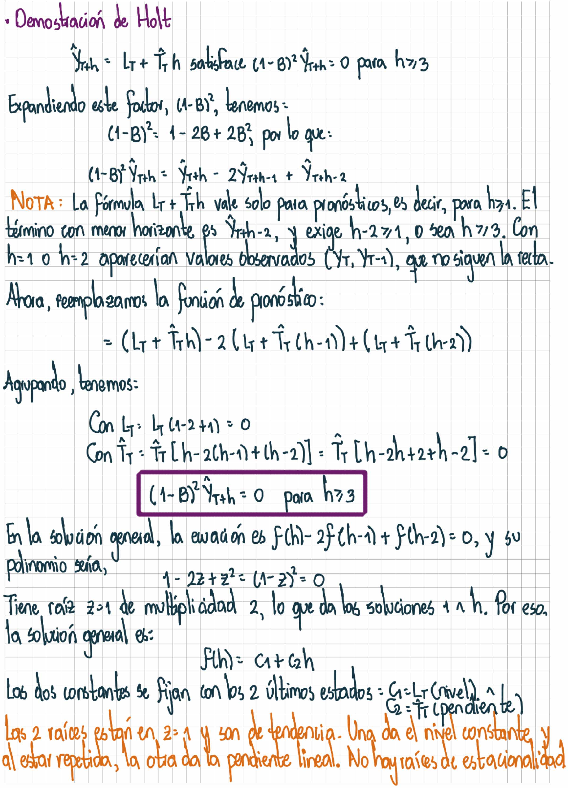{width=90%}

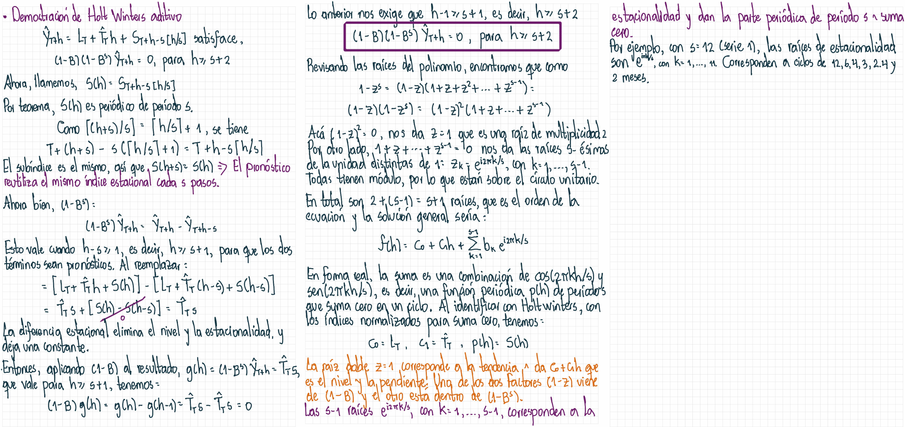{width=100%}

# 5. Dependencia y estacionariedad

Esta sección se hace sobre la serie transformada elegida en la sección 4: $(1-B^{12})Y_t$ en la serie 1, $Y_t$ en la serie 2 y $(1-B)Y_t$ en la serie 3.

## 5(a) ACF, PACF por Durbin-Levinson y las dos bandas

`pacf_dl(r)` calcula la PACF con la recursión de Durbin y Levinson a partir de $r_1, \ldots, r_m$: $\phi_{11} = r_1$ y, para $k \ge 2$,
$$\phi_{kk} = \frac{r_k - \sum_{j=1}^{k-1}\phi_{k-1,j}\, r_{k-j}}{1 - \sum_{j=1}^{k-1}\phi_{k-1,j}\, r_j}, \qquad \phi_{kj} = \phi_{k-1,j} - \phi_{kk}\,\phi_{k-1,k-j}.$$
La verificación contra `pacf()` da diferencias del orden de $10^{-14}$, por debajo de $10^{-10}$:

```{r}
#| label: verif-pacf
#| comment: ""
lineas("PACF Durbin-Levinson")
```

Los correlogramas dibujan dos bandas al 95 %, y cada una responde una pregunta distinta:

- **La banda de ruido blanco**, $\pm 1.96/\sqrt{n}$, en azul, responde *¿es esta serie ruido blanco?* Bajo esa hipótesis todos los $\rho_h$ son cero y $r_h \approx N(0, 1/n)$. Sirve para decidir si queda dependencia y para leer la PACF.
- **La banda de Bartlett**, $\pm 1.96\sqrt{\left(1 + 2\sum_{i<h} r_i^2\right)/n}$, en rojo, responde *¿se cortó la ACF antes del rezago $h$?* Supone que $\rho_i$ puede ser distinto de cero para $i < h$ y que $\rho_j = 0$ para $j \ge h$, como en un MA($h-1$). Sirve para identificar dónde se corta la ACF.

## 5(b) Ljung-Box y forma de la ACF y la PACF

En cada serie se toma $m = \min\{\lfloor n/4 \rfloor, 24\}$ y, como contraste, un $m$ corto, $\lceil \ln n \rceil$. El $m$ debe cubrir los rezagos donde el correlograma muestra la estructura, sin sumar muchos rezagos vacíos que le resten potencia a la prueba. Como la prueba se aplica a una serie y no a los errores de un método, no hay parámetros estimados y $p = 0$.

```{r}
#| label: lb-cifras
lb1 <- dep("serie1")$ljung_box
lb2 <- dep("serie2")$ljung_box
lb3 <- dep("serie3")$ljung_box_corto
lb1c <- dep("serie1")$ljung_box_corto
lb3l <- dep("serie3")$ljung_box
```

### Serie 1: $(1-B^{12})Y_t$

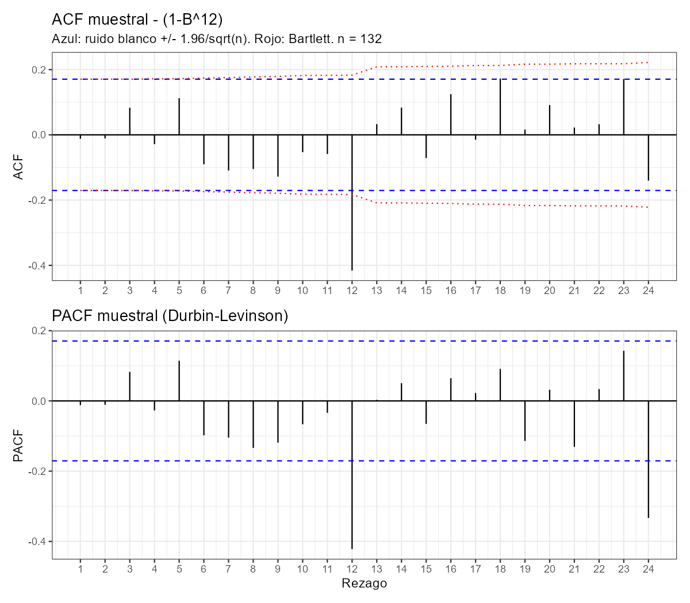{width=85%}

**Elección de $m$.** La estructura está en el rezago 12, así que se usa $m = `r lb1$m`$, que cubre los rezagos 12 y 24. Con el $m$ corto, $m = `r lb1c$m`$, la prueba no incluye el rezago 12 y no rechaza ($Q = `r f(lb1c$estadistico)`$, valor p `r vp(lb1c$valor_p)`).

1. **Hipótesis:** $H_0: \rho_1 = \cdots = \rho_{`r lb1$m`} = 0$ frente a $H_1$: algún $\rho_h \neq 0$ con $h \le `r lb1$m`$.
2. **Estadístico:** $Q_m = n(n+2)\sum_{h=1}^{m} r_h^2/(n-h)$, con $n = `r dep("serie1")$n`$. Bajo $H_0$, $Q_m \sim \chi^2_{m} = \chi^2_{`r lb1$grados_libertad`}$.
3. **Región de rechazo al 5 %:** $Q_m > \chi^2_{0.95;\,`r lb1$grados_libertad`} = `r f(lb1$valor_critico, 3)`$.
4. **Valor observado:** $Q_m = `r f(lb1$estadistico, 3)`$, valor p `r vp(lb1$valor_p)`.
5. **Decisión:** `r dec(lb1$valor_p)`
6. **Lectura:** $(1-B^{12})Y_t$ no es ruido blanco; queda dependencia, y está concentrada en el rezago estacional.

**Forma.** La ACF tiene un solo pico grande, $r_{12} = `r f(dep("serie1")$acf[12], 3)`$; $r_{18}$ y $r_{23}$ salen de la banda de ruido blanco pero quedan dentro de la de Bartlett, así que, dado que la ACF ya se cortó en 12, no son evidencia de más estructura. La PACF tiene picos negativos en 12 ($`r f(dep("serie1")$pacf[12], 3)`$) y 24 ($`r f(dep("serie1")$pacf[24], 3)`$) que decaen. **Es compatible con un MA(1) estacional** de período 12, $X_t = (1 + \Theta B^{12})\varepsilon_t$ con $\Theta < 0$: la ACF se corta después de 12 y la PACF decae en los rezagos estacionales. **No es compatible** con un AR estacional, cuya PACF se cortaría y cuya ACF decaería, ni con ruido blanco. Un MA(1) solo puede producir $|\rho| \le 0.5$, y $r_{12} = `r f(dep("serie1")$acf[12], 3)`$ está cerca del límite: el MA estacional está cerca de ser no invertible, señal de que la estacionalidad es casi determinista.

### Serie 2: $Y_t$

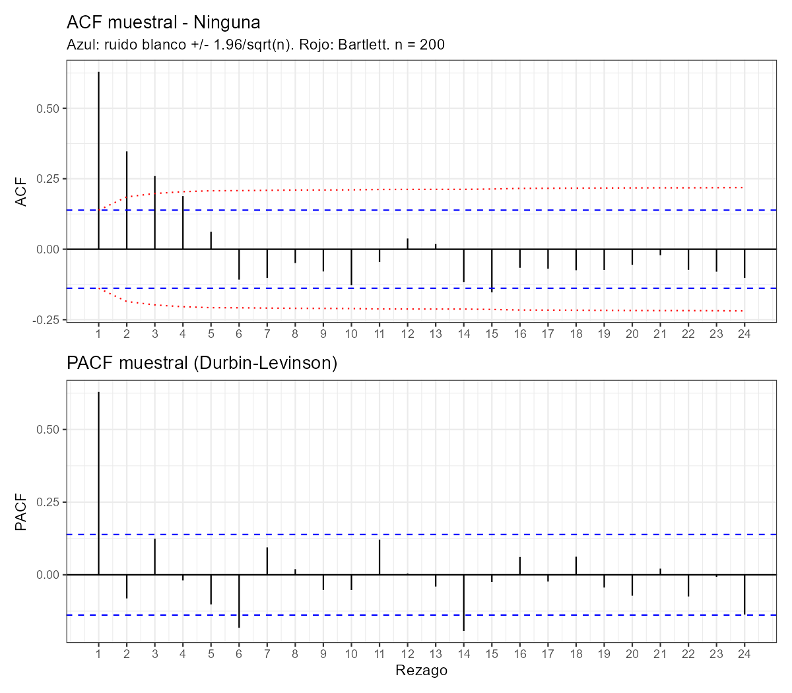{width=85%}

**Elección de $m$.** La dependencia está en los primeros rezagos, y la prueba la detecta con cualquier $m$ (con $m = `r dep("serie2")$m_corto`$, $Q = `r f(dep("serie2")$ljung_box_corto$estadistico)`$, valor p `r vp(dep("serie2")$ljung_box_corto$valor_p)`). Se usa $m = `r lb2$m`$, que además revisa los rezagos semanales 7, 14 y 21.

1. **Hipótesis:** $H_0: \rho_1 = \cdots = \rho_{`r lb2$m`} = 0$ frente a $H_1$: algún $\rho_h \neq 0$ con $h \le `r lb2$m`$.
2. **Estadístico:** $Q_m = n(n+2)\sum_{h=1}^{m} r_h^2/(n-h)$, con $n = `r dep("serie2")$n`$. Bajo $H_0$, $Q_m \sim \chi^2_{`r lb2$grados_libertad`}$.
3. **Región de rechazo al 5 %:** $Q_m > \chi^2_{0.95;\,`r lb2$grados_libertad`} = `r f(lb2$valor_critico, 3)`$.
4. **Valor observado:** $Q_m = `r f(lb2$estadistico, 3)`$, valor p `r vp(lb2$valor_p)`.
5. **Decisión:** `r dec(lb2$valor_p)`
6. **Lectura:** el consumo de un día depende del de los días anteriores; la serie no es ruido blanco.

**Forma.** La ACF decae geométricamente (`r paste(f(dep("serie2")$acf[1:4], 3), collapse = ", ")`) y la PACF se corta después del rezago 1 ($\hat\phi_{11} = `r f(dep("serie2")$pacf[1], 3)`$). **Es compatible con un AR(1)** con $\phi \approx `r f(dep("serie2")$pacf[1])`$: ese proceso predice $\rho_h = \phi^h$, es decir `r paste(f(dep("serie2")$pacf[1]^(1:4), 3), collapse = ", ")`, muy cerca de lo observado. **No es compatible** con un MA($q$), porque la ACF no se corta, ni con ruido blanco.

### Serie 3: $(1-B)Y_t$

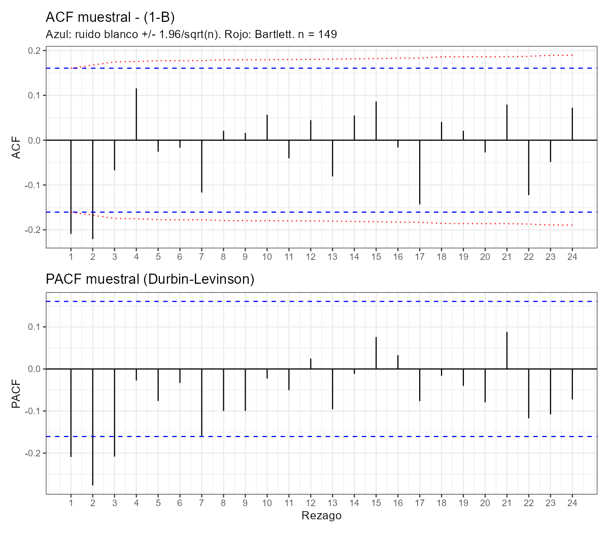{width=85%}

**Elección de $m$.** La dependencia está solo en los rezagos 1 y 2. Con $m = `r lb3l$m`$ esos dos rezagos quedan diluidos entre 22 casi nulos y la prueba no rechaza ($Q = `r f(lb3l$estadistico)`$, valor p `r vp(lb3l$valor_p)`), aunque $r_1$ y $r_2$ salen de la banda uno por uno. Por eso se usa el $m$ corto, $m = `r lb3$m`$.

1. **Hipótesis:** $H_0: \rho_1 = \cdots = \rho_{`r lb3$m`} = 0$ frente a $H_1$: algún $\rho_h \neq 0$ con $h \le `r lb3$m`$.
2. **Estadístico:** $Q_m = n(n+2)\sum_{h=1}^{m} r_h^2/(n-h)$, con $n = `r dep("serie3")$n`$. Bajo $H_0$, $Q_m \sim \chi^2_{`r lb3$grados_libertad`}$.
3. **Región de rechazo al 5 %:** $Q_m > \chi^2_{0.95;\,`r lb3$grados_libertad`} = `r f(lb3$valor_critico, 3)`$.
4. **Valor observado:** $Q_m = `r f(lb3$estadistico, 3)`$, valor p `r vp(lb3$valor_p)`.
5. **Decisión:** `r dec(lb3$valor_p)`
6. **Lectura:** el crecimiento mensual de usuarios no es ruido blanco: un mes de crecimiento alto tiende a seguirse de uno o dos meses de crecimiento menor.

**Forma.** $r_1 = `r f(dep("serie3")$acf[1], 3)`$ y $r_2 = `r f(dep("serie3")$acf[2], 3)`$ salen de la banda y desde el rezago 3 todo queda dentro, mientras que la PACF decae (`r paste(f(dep("serie3")$pacf[1:3], 3), collapse = ", ")`). **Es compatible con un MA(2)** con coeficientes negativos: la ACF se corta en 2 y la PACF decae. **No es compatible** con un AR, cuya PACF se cortaría, ni con ruido blanco.

## 5(c) Estacionariedad, ergodicidad y la media

Cada serie transformada se divide en cuatro bloques consecutivos. Si la serie es estacionaria, la media y la varianza no deben cambiar de forma sistemática entre bloques.

```{r}
#| label: bloques
#| echo: true
#| results: asis
for (k in names(resultados)) {
  cat("\n**", resultados[[k]]$ficha$nombre, ", ", resultados[[k]]$transformacion$elegida, "**\n\n", sep = "")
  print(knitr::kable(dep(k)$bloques, col.names = c("Bloque", "n", "Media", "Varianza"), digits = 3))
  cat("\n")
}
```

La media se estima con dos errores estándar. El **ingenuo**, $\hat\sigma/\sqrt{n}$, supone observaciones independientes. El de **largo plazo**, $\sqrt{\hat\sigma^2_{LP}/n}$, usa `varianza_largo_plazo()`:
$$\hat\sigma^2_{LP} = \hat\gamma(0) + 2\sum_{h=1}^{L}\left(1 - \frac{h}{L+1}\right)\hat\gamma(h), \qquad L = \lfloor 4(n/100)^{2/9} \rfloor,$$
con los pesos del núcleo de Bartlett. Los intervalos al 95 % son $\bar x \pm 1.96\,\widehat{EE}$.

```{r}
#| label: intervalos
#| echo: true
#| results: asis
for (k in names(resultados)) {
  d <- dep(k)
  cat("\n**", resultados[[k]]$ficha$nombre, "**: media = ", f(d$media, 3), ", L = ", d$L,
      ", $\\hat\\gamma(0)$ = ", f(d$gamma0, 3), ", $\\hat\\sigma^2_{LP}$ = ", f(d$varianza_largo_plazo, 3), "\n\n", sep = "")
  print(knitr::kable(d$intervalos, col.names = c("Error estándar", "Valor", "Límite inferior", "Límite superior"), digits = 3))
  cat("\n")
}
```

**Por qué difieren.** $\hat\sigma^2_{LP}$ suma a $\hat\gamma(0)$ las autocovarianzas de los primeros $L$ rezagos. Con autocorrelación positiva, observaciones cercanas repiten información, la muestra equivale a menos datos independientes y la incertidumbre real es mayor que la que supone el error ingenuo; con autocorrelación negativa, los errores se compensan y la incertidumbre es menor. **El adecuado en las tres series es el de largo plazo**, porque las tres tienen dependencia según la sección 5(b).

- **Serie 1.** Las medias por bloque (`r paste(f(dep("serie1")$bloques$media), collapse = ", ")`) y las varianzas son estables. Los dos intervalos casi coinciden, porque $r_1, \ldots, r_4$ son casi cero y la ventana $L = `r dep("serie1")$L`$ no alcanza el rezago 12, donde está la dependencia. **La media representa el crecimiento interanual de la demanda:** cada mes, la demanda supera en unos `r f(dep("serie1")$media, 1)` GWh a la del mismo mes del año anterior, con intervalo de largo plazo de `r f(dep("serie1")$intervalos$limite_inferior[2], 1)` a `r f(dep("serie1")$intervalos$limite_superior[2], 1)` GWh, que contiene a $12\hat\beta_1 = `r f(fila("serie1", "(1-B^12)", "media_esperada"), 1)`$.
- **Serie 2.** Las medias por bloque son estables (`r paste(f(dep("serie2")$bloques$media), collapse = ", ")`); el tercer bloque tiene menor varianza, un período más tranquilo, pero sin tendencia. El error de largo plazo es `r f(dep("serie2")$intervalos$valor[2] / dep("serie2")$intervalos$valor[1])` veces el ingenuo, por la autocorrelación positiva: el intervalo ingenuo subestima la incertidumbre. **La media representa el consumo diario típico de la estación**, `r f(dep("serie2")$media, 1)` MWh, con intervalo de largo plazo de `r f(dep("serie2")$intervalos$limite_inferior[2], 2)` a `r f(dep("serie2")$intervalos$limite_superior[2], 2)` MWh.
- **Serie 3.** Las medias por bloque (`r paste(f(dep("serie3")$bloques$media, 3), collapse = ", ")`) y las varianzas son estables. Aquí el intervalo de largo plazo es más angosto que el ingenuo, porque las autocorrelaciones de los rezagos 1 y 2 son negativas. **La media representa el crecimiento mensual de la red**: `r f(dep("serie3")$media, 2)` mil usuarios por mes, con intervalo de largo plazo de `r f(dep("serie3")$intervalos$limite_inferior[2], 2)` a `r f(dep("serie3")$intervalos$limite_superior[2], 2)` mil, que contiene la pendiente por mínimos cuadrados de `r f(resultados$serie3$transformacion$pendiente_mco, 2)`.

# 6. Pronóstico y evaluación

## 6(a) Métodos, asignación y optimización

Los parámetros se eligieron exclusivamente sobre las primeras $n_0=\lfloor0.8T\rfloor$ observaciones de cada serie. Las rejillas son las exigidas por la guía: $k=2,\ldots,12$ para media móvil; $\alpha=0.02,\ldots,0.98$ para SES; $k=3,\ldots,12$ para doble media móvil; paso 0.05 para $(\alpha,\beta)$ de Holt; y paso 0.1 para $(\alpha,\beta,\gamma)$ de Holt-Winters. El criterio es el MSE de los pronósticos de un paso disponibles después del calentamiento de cada método. Este MSE elige parámetros **dentro de cada método**; todavía no se usa para ordenar métodos, tarea reservada al origen móvil sobre orígenes comunes.

Cada método se verificó en ejemplos pequeños cuyo resultado se conoce a mano. El ingenuo y el ingenuo estacional se probaron sobre la secuencia 1, ..., 16; la media, la media móvil, el SES y la doble media móvil, sobre 1, ..., 12 (por ejemplo, con $\alpha = 0.5$ el SES da $\hat Y_2 = 1$ y $\hat Y_3 = 1.5$); las tres tendencias, sobre series exactas lineal, cuadrática y exponencial, cuyos pronósticos deben coincidir con la fórmula; la tendencia con ficticias y Holt-Winters, sobre series con efectos estacionales conocidos, y Holt, sobre una serie constante. Los coeficientes de la tendencia lineal se contrastaron además con `lm()`. Las pruebas están en `tests/`, se ejecutan desde `correr-todo.R` y su resultado aparece en los bloques de verificación al final del informe.

La selección se hace primero por compatibilidad estructural: a la serie 1, que es estacional, se le asignan métodos capaces de representar estacionalidad; a las series 2 y 3, sin estacionalidad material, se les asignan métodos no estacionales acordes con su nivel o tendencia. “Contraste” identifica un candidato cuya forma contradice deliberadamente el diagnóstico cuando resulta informativo. El catálogo de 13 métodos aplicado a 3 series produce 39 combinaciones posibles; este filtro conserva 15 combinaciones método-serie para la evaluación.

```{r}
#| label: asignacion-metodos
#| echo: true
tabla_asignacion |>
  select(metodo, serie, rol) |>
  pivot_wider(names_from = serie, values_from = rol) |>
  knitr::kable(
    col.names = c("Metodo", "Serie 1", "Serie 2", "Serie 3")
  )
```

La evidencia que gobierna cada decisión se presenta por combinación método-serie. Así se distingue si el método representa el patrón diagnosticado, si omite una estructura necesaria o si introduce deliberadamente un supuesto usado como contraste:

```{r}
#| label: evidencia-asignacion
#| echo: true
#| results: asis
tabla_asignacion |>
  select(serie, metodo, rol, evidencia) |>
  group_split(serie) |>
  purrr::walk(function(tb) {
    cat("\n**", unique(tb$serie), "**\n\n", sep = "")
    print(knitr::kable(
      select(tb, metodo, rol, evidencia),
      col.names = c("Método", "Decisión", "Evidencia")
    ))
    cat("\n")
  })
```

Con esta distribución, los trece métodos se aplican al menos una vez. Las series 1 y 3 conservan un contraste estructural; en la serie 2 se omite el ingenuo estacional porque no existe evidencia de estacionalidad semanal. Los parámetros seleccionados en el tramo de estimación son:

```{r}
#| label: optimos-estimacion
#| echo: true
tabla_optimos |>
  select(serie, metodo, parametros, mse_estimacion) |>
  arrange(serie, metodo) |>
  knitr::kable(
    col.names = c("Serie", "Método", "Parámetros", "MSE de estimación"),
    digits = 3
  )
```

### Curvas y mapas de MSE

La marca roja en las curvas y la cruz blanca en los mapas identifican el mínimo de la rejilla.

**Serie 1**

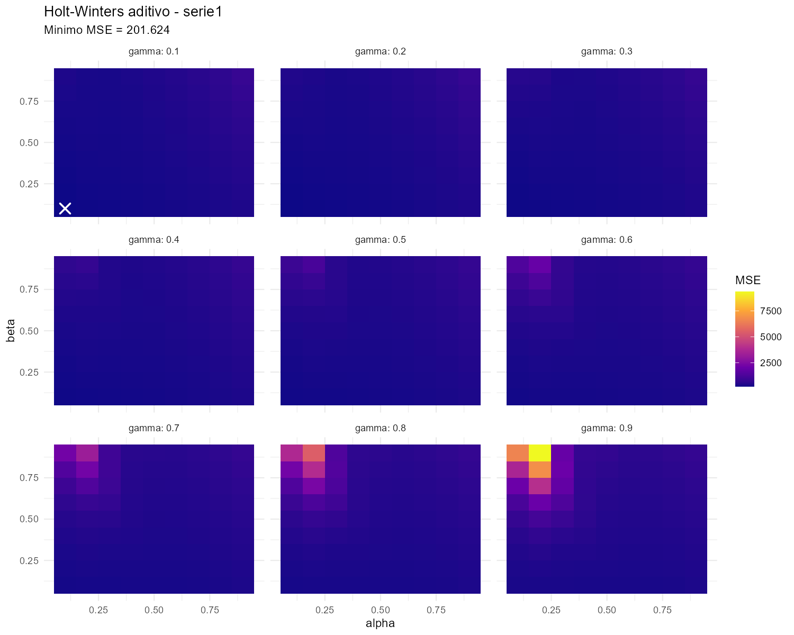{width=48%}
{width=48%}

**Serie 2**

{width=48%}
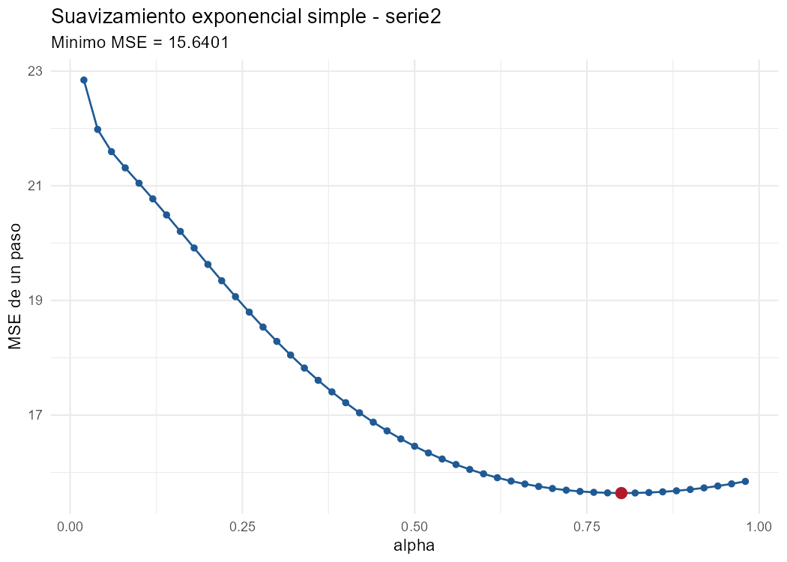{width=48%}

**Serie 3**

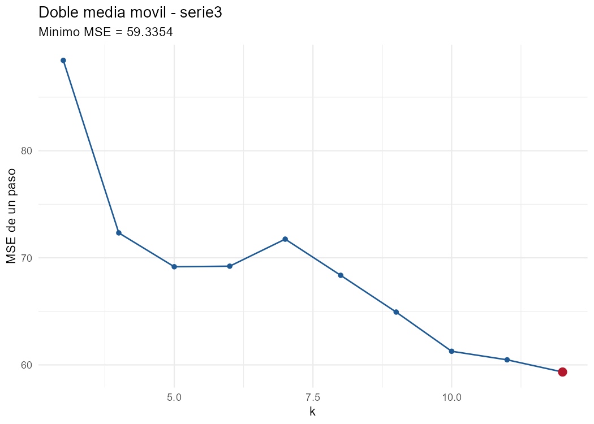{width=48%}
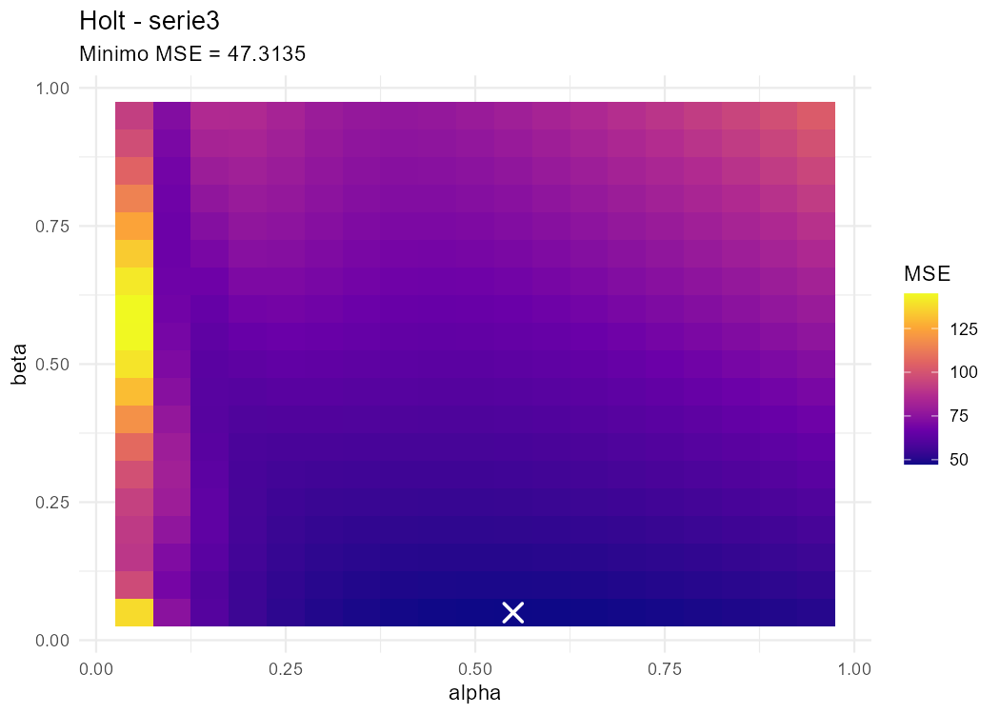{width=48%}

## 6(b) Regresiones

Las regresiones se ajustan sobre el tramo de estimación. Para cada coeficiente $\beta_j$ se contrasta
$$H_0:\beta_j=0\qquad\text{contra}\qquad H_1:\beta_j\ne0.$$
La prueba usa el error estándar HAC con núcleo de Bartlett, porque la autocorrelación residual invalida el error ordinario aunque los coeficientes de mínimos cuadrados conserven su interpretación. El estadístico es
$$t_j=\frac{\hat\beta_j}{EE_{HAC}(\hat\beta_j)}\sim t_{n-q}\quad\text{bajo }H_0,$$
donde $q$ es el número de coeficientes de la regresión. Al 5 % se rechaza $H_0$ cuando $|t_j|>t_{0.975;n-q}$; equivalentemente, cuando el valor p bilateral es menor que 0.05. En la tendencia exponencial, coeficientes y residuos están en escala logarítmica. Las tablas presentan, en orden, el estadístico observado, sus grados de libertad, el valor crítico, el valor p y la decisión para cada coeficiente.

```{r}
#| label: coeficientes-regresiones
#| echo: true
#| results: asis
claves <- unique(tabla_coeficientes_regresion[, c("serie", "metodo", "escala")])
for (i in seq_len(nrow(claves))) {
  clave <- claves[i, ]
  tb <- tabla_coeficientes_regresion |>
    filter(serie == clave$serie, metodo == clave$metodo) |>
    select(termino, estimacion, se_ordinario, se_hac, t_robusto,
           grados_libertad, valor_critico, p_valor_robusto, decision)
  cat("\n**", clave$serie, " - ", clave$metodo,
      " (escala ", clave$escala, ")**\n\n", sep = "")
  print(knitr::kable(
    tb,
    col.names = c("Término", "Estimación", "EE ordinario", "EE HAC", "t robusto",
                  "gl", "Crítico", "Valor p", "Decisión"),
    digits = 4
  ))
  cat("\n")
}
```

**Lectura de las decisiones.** En la serie 1 se rechaza $H_0$ para el intercepto, la pendiente positiva y todos los contrastes estacionales mostrados: hay evidencia de crecimiento y de diferencias mensuales respecto a la estación de referencia. En la serie 3, intercepto y pendiente son significativos en las tendencias lineal, cuadrática y exponencial, pero el término cuadrático no lo es (valor p `r vp(tabla_coeficientes_regresion$p_valor_robusto[tabla_coeficientes_regresion$serie == "serie3" & tabla_coeficientes_regresion$metodo == "Tendencia cuadratica" & tabla_coeficientes_regresion$termino == "t2"])`). En la regresión estacional de contraste se rechaza $H_0$ para intercepto y pendiente, pero no para ninguno de los contrastes mensuales. En términos de la serie, la evidencia sostiene un crecimiento aproximadamente lineal y no sostiene estacionalidad material en los usuarios conectados.

### Dependencia residual

La tabla reúne tres diagnósticos complementarios. El primero es el **contraste individual de autocorrelación** en el rezago 1:
$$H_0:\rho_1=0 \qquad\text{contra}\qquad H_1:\rho_1\ne0.$$
Bajo ruido blanco, $r_1\approx N(0,1/n)$; al 5 % se rechaza $H_0$ cuando $|r_1|>1.96/\sqrt{n}$. Las columnas $r_1$ y *Banda* contienen el valor observado y ese límite bilateral. El correlograma extiende la misma comparación a cada rezago, pero debe leerse junto con un contraste conjunto para no multiplicar decisiones aisladas.

El segundo diagnóstico es la **prueba conjunta de Ljung-Box**. Para cada regresión se contrasta
$$H_0:\rho_1=\cdots=\rho_m=0 \qquad\text{contra}\qquad H_1:\text{alguna }\rho_h\ne0.$$
El estadístico es $Q_m=n(n+2)\sum_{h=1}^m r_h^2/(n-h)$ y se refiere a $\chi_m^2$: los coeficientes de regresores deterministas no se descuentan de los grados de libertad. Se usa $m=\min\{\lfloor n/4\rfloor,24\}=24$. La tabla contiene los seis elementos de la prueba, además de $r_1$ y Durbin-Watson.

El tercero es el **estadístico de Durbin-Watson**,
$$d=\frac{\sum_{t=2}^{n}(e_t-e_{t-1})^2}{\sum_{t=1}^{n}e_t^2}\approx2(1-r_1).$$
Su rango es de 0 a 4. Un valor cercano a 2 es compatible con ausencia de autocorrelación de primer orden; $d<2$ indica autocorrelación positiva y $d>2$, negativa. Aquí se usa como diagnóstico, no como una prueba con región de rechazo: las columnas *DW* y $2(1-r_1)$ permiten verificar tanto su lectura como la aproximación.

```{r}
#| label: diagnostico-dependencia-regresiones
#| echo: true
tabla_dependencia_regresion |>
  select(serie, metodo, escala, n, m, r1, banda, Q, gl,
         valor_critico, valor_p, decision, DW, aproximacion_DW) |>
  knitr::kable(
    col.names = c("Serie", "Metodo", "Escala", "n", "m", "r1", "Banda",
                  "Q", "gl", "Critico", "Valor p", "Decision", "DW", "2(1-r1)"),
    digits = 4
  )
```

**Serie 1.** La tendencia con ficticias no rechaza ausencia conjunta de autocorrelación ($Q=`r f(tabla_dependencia_regresion$Q[1])`$, valor p `r vp(tabla_dependencia_regresion$valor_p[1])`). $DW=`r f(tabla_dependencia_regresion$DW[1])`$ es prácticamente 2 y coincide con $2(1-r_1)$: después de retirar tendencia y estacionalidad no queda dependencia lineal detectable.

**Serie 3.** Las cuatro regresiones rechazan $H_0$. Sus $r_1$ están entre `r f(min(tabla_dependencia_regresion$r1[tabla_dependencia_regresion$serie == "serie3"]), 3)` y `r f(max(tabla_dependencia_regresion$r1[tabla_dependencia_regresion$serie == "serie3"]), 3)`, y los valores de Durbin-Watson entre `r f(min(tabla_dependencia_regresion$DW[tabla_dependencia_regresion$serie == "serie3"]), 3)` y `r f(max(tabla_dependencia_regresion$DW[tabla_dependencia_regresion$serie == "serie3"]), 3)` señalan autocorrelación positiva. Las formas deterministas describen el crecimiento, pero no capturan toda la dinámica mensual; la tendencia exponencial deja la mayor dependencia.

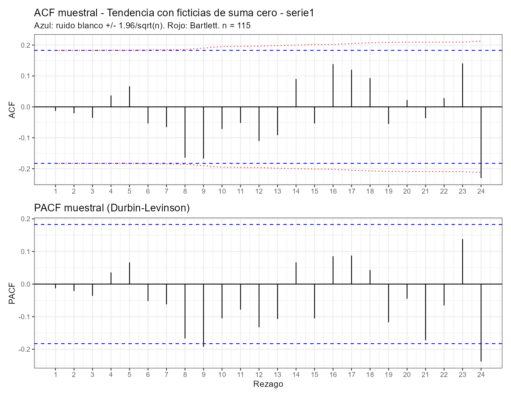{width=70%}

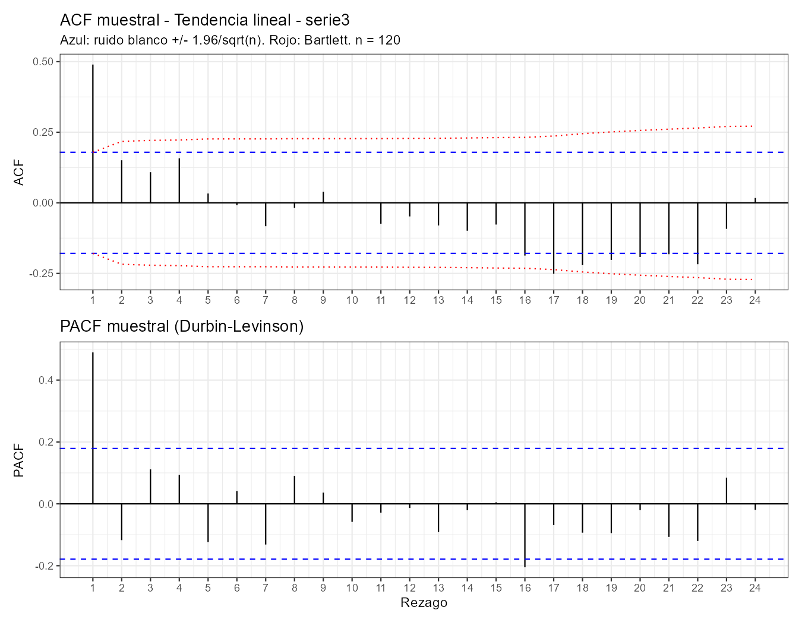{width=48%}
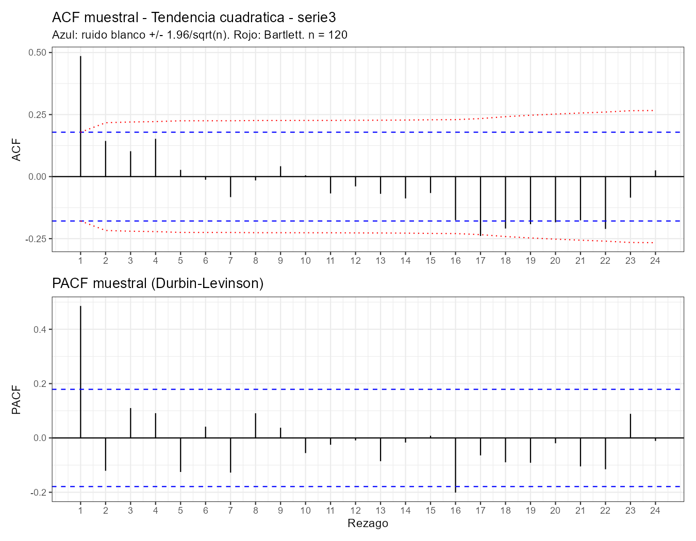{width=48%}

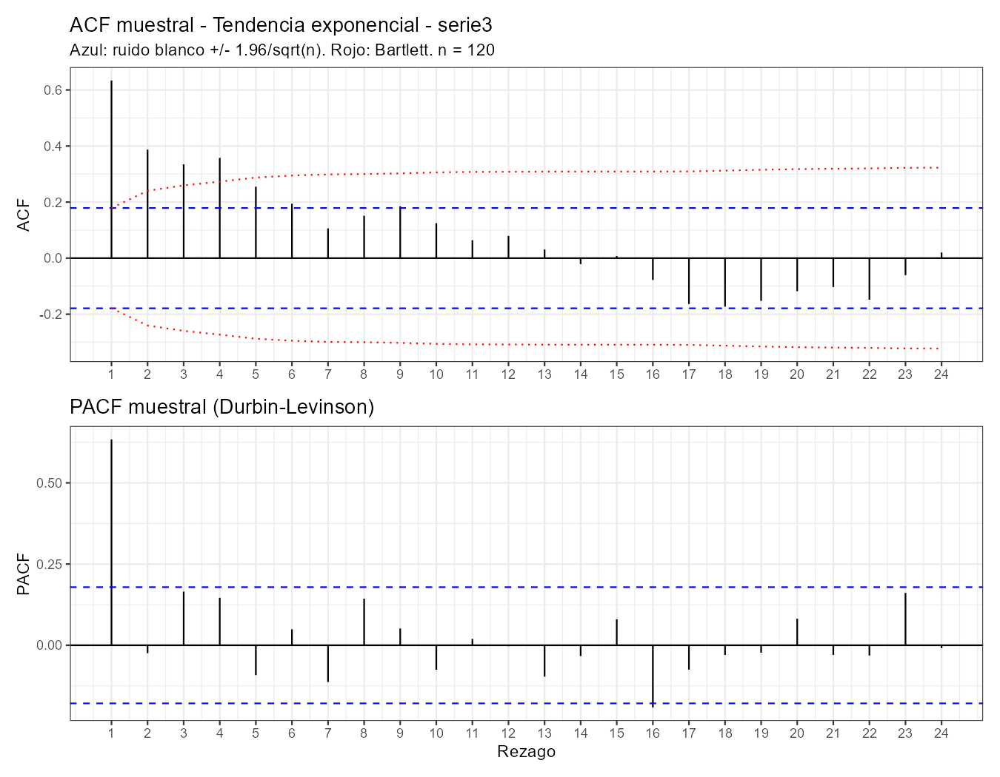{width=48%}
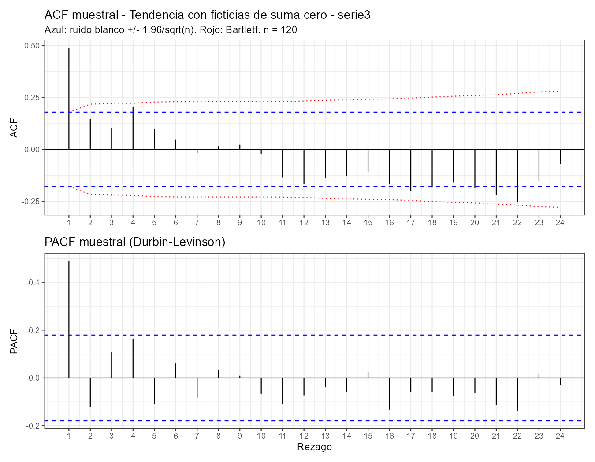{width=48%}

### Normalidad residual

La **prueba de Jarque-Bera** examina conjuntamente la asimetría y la curtosis de los residuos. Sus hipótesis son
$$H_0:S=0\text{ y }K=3\quad\text{(compatibilidad con normalidad)}$$
$$H_1:S\ne0\text{ o }K\ne3\quad\text{(incumplimiento de al menos una condición)}.$$
Si $m_j=n^{-1}\sum_{t=1}^{n}(e_t-\bar e)^j$, la asimetría y la curtosis muestrales son
$$S=\frac{m_3}{m_2^{3/2}},\qquad K=\frac{m_4}{m_2^2},$$
y el estadístico es
$$JB=\frac{n}{6}\left[S^2+\frac{(K-3)^2}{4}\right].$$
Bajo $H_0$ y en muestras grandes, $JB\sim\chi_2^2$. Al 5 %, se rechaza la normalidad si $JB>\chi^2_{0.95;2}=5.991$ o, equivalentemente, si el valor p es menor que 0.05. La tabla presenta las hipótesis mediante las columnas observadas de asimetría y curtosis, el estadístico, sus dos grados de libertad, el valor crítico, el valor p y la decisión.

No rechazar $H_0$ no demuestra que los residuos sean exactamente normales; significa que estas dos características muestrales no aportan evidencia suficiente contra la normalidad. Además, la normalidad es instrumental para inferencia e intervalos y no sustituye la condición sustantiva de residuos sin autocorrelación.

```{r}
#| label: diagnostico-normalidad-regresiones
#| echo: true
tabla_normalidad_regresion |>
  select(serie, metodo, escala, JB, gl, valor_critico, valor_p,
         decision, asimetria, curtosis) |>
  knitr::kable(
    col.names = c("Serie", "Metodo", "Escala", "JB", "gl", "Critico",
                  "Valor p", "Decision", "Asimetria", "Curtosis"),
    digits = 4
  )
```

Jarque-Bera no rechaza normalidad en ninguna regresión al 5 %. Esta conclusión no rescata las regresiones de la serie 3 como modelos completos: sus residuos siguen autocorrelacionados según Ljung-Box y Durbin-Watson.

## 6(c) Evaluación por origen móvil

La evaluación simula el uso real del pronóstico mediante una ventana expansiva. El primer origen es $n_0$: se ajusta el modelo con $y_1,\ldots,y_{n_0}$ y se pronostican hasta $H$ períodos. Luego el origen avanza una observación, se incorpora el dato recién disponible, se vuelve a ajustar el modelo con $y_1,\ldots,y_{n_0+1}$ y se repite el proceso. Por tanto, el modelo sí se reestima en cada origen; lo que permanece fijo son los hiperparámetros elegidos exclusivamente en el tramo inicial de estimación, como $k$, $\alpha$, $\beta$ y $\gamma$.

Para cada método se calculan errores $e_{o,h}=y_{o+h}-\hat y_{o+h\mid o}$ sobre los mismos orígenes. En cada horizonte se resumen mediante
$$RMSE_h=\sqrt{\frac{1}{N_h}\sum_o e_{o,h}^2},\qquad
MAD_h=\frac{1}{N_h}\sum_o|e_{o,h}|,$$
$$MAPE_h=\frac{100}{N_h}\sum_o\left|\frac{e_{o,h}}{y_{o+h}}\right|.$$
El RMSE determina el orden de las tablas; MAD y MAPE complementan la lectura con error absoluto y porcentual. La columna *Mejora RMSE (%)* es positiva cuando el método supera al referente y negativa cuando queda por debajo.

Se elige como referente el ingenuo estacional para la serie 1, porque su patrón mensual exige comparar contra el valor del mismo mes anterior. Para las series 2 y 3 se usa el ingenuo ordinario, coherente con la ausencia de estacionalidad material. El referente se calcula sobre exactamente los mismos orígenes que los demás métodos.

```{r}
#| label: tablas-origen-movil
#| echo: true
#| results: asis
for (k in names(config)) {
  for (h in c(1L, config[[k]]$H)) {
    tb <- tabla_origen_movil |>
      filter(serie == k, horizonte == h) |>
      select(metodo, rol, n_errores, RMSE, MAD, MAPE, mejora_rmse_pct) |>
      arrange(RMSE)
    cat("\n### ", resultados[[k]]$ficha$nombre, ": horizonte $h=", h, "$\n\n", sep = "")
    print(knitr::kable(
      tb,
      col.names = c("Método", "Rol", "Errores", "RMSE", "MAD", "MAPE (%)",
                    "Mejora RMSE (%)"),
      digits = 3
    ))
    cat("\n")
  }
}
```

Las tablas usan `r tabla_origen_movil$n_errores[tabla_origen_movil$serie == "serie1" & tabla_origen_movil$horizonte == 1][1]`, `r tabla_origen_movil$n_errores[tabla_origen_movil$serie == "serie2" & tabla_origen_movil$horizonte == 1][1]` y `r tabla_origen_movil$n_errores[tabla_origen_movil$serie == "serie3" & tabla_origen_movil$horizonte == 1][1]` errores a un paso para las series 1, 2 y 3. En el horizonte máximo quedan, respectivamente, `r tabla_origen_movil$n_errores[tabla_origen_movil$serie == "serie1" & tabla_origen_movil$horizonte == config$serie1$H][1]`, `r tabla_origen_movil$n_errores[tabla_origen_movil$serie == "serie2" & tabla_origen_movil$horizonte == config$serie2$H][1]` y `r tabla_origen_movil$n_errores[tabla_origen_movil$serie == "serie3" & tabla_origen_movil$horizonte == config$serie3$H][1]`, porque los últimos orígenes ya no disponen de una realización futura a distancia $H$. Que un método no supere al referente en esta etapa no lo elimina automáticamente; la selección y validación del ganador corresponden a la iteración siguiente.

- **Serie 1.** La tendencia con ficticias obtiene el menor RMSE a un paso (`r f(mejor_om("serie1", 1)$RMSE, 3)`) y Holt-Winters aditivo en $h=12$ (`r f(mejor_om("serie1", config$serie1$H)$RMSE, 3)`). Ambos superan ampliamente al ingenuo estacional, lo que muestra el valor de representar conjuntamente tendencia y estacionalidad.
- **Serie 2.** SES encabeza $h=1$ con RMSE `r f(mejor_om("serie2", 1)$RMSE, 3)`, mientras la media simple encabeza $h=7$ con `r f(mejor_om("serie2", config$serie2$H)$RMSE, 3)`. La comparación queda restringida a métodos no estacionales, coherentes con el patrón observado.
- **Serie 3.** Holt presenta el menor RMSE a un paso (`r f(mejor_om("serie3", 1)$RMSE, 3)`) y la tendencia cuadrática en $h=21$ (`r f(mejor_om("serie3", config$serie3$H)$RMSE, 3)`). La ventaja de las tendencias en el horizonte largo es marcada frente al ingenuo, aunque la decisión definitiva todavía debe pasar por la validación reservada para 6(d).

## 6(d) Validación de los ganadores

El ganador de cada serie es el método con menor RMSE en $h=1$. La validación usa exclusivamente sus errores de origen móvil a un paso, $e_{o,1}=y_{o+1}-\hat y_{o+1\mid o}$; no usa los residuos internos del ajuste. Los ganadores sometidos a diagnóstico son:

```{r}
#| label: ganadores-h1
#| echo: true
ganadores_h1 |>
  select(serie, metodo, n_errores, RMSE, rmse_referente, mejora_rmse_pct) |>
  knitr::kable(
    col.names = c("Serie", "Ganador", "Errores", "RMSE", "RMSE referente",
                  "Mejora RMSE (%)"),
    digits = 3
  )
```

### Errores en el tiempo y correlogramas

Los gráficos temporales permiten detectar cambios de nivel, dispersión o rachas. En los correlogramas, la banda azul es $\pm1.96/\sqrt{n_e}$ y se calcula separadamente con los `r vg(tabla_dependencia_ganadores, "serie1", "n")`, `r vg(tabla_dependencia_ganadores, "serie2", "n")` y `r vg(tabla_dependencia_ganadores, "serie3", "n")` errores disponibles. La banda roja de Bartlett se presenta como referencia adicional para la ACF.

**Serie 1: tendencia con ficticias de suma cero**

{width=48%}
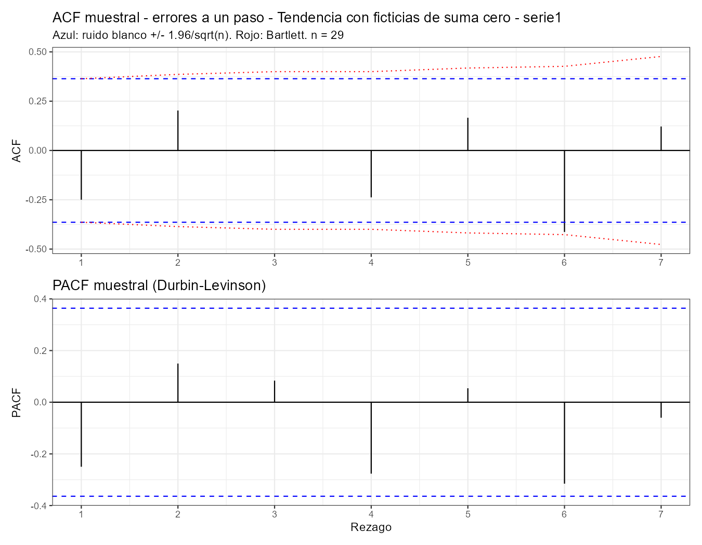{width=48%}

**Serie 2: suavizamiento exponencial simple**

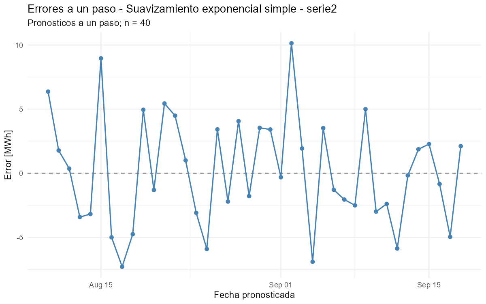{width=48%}
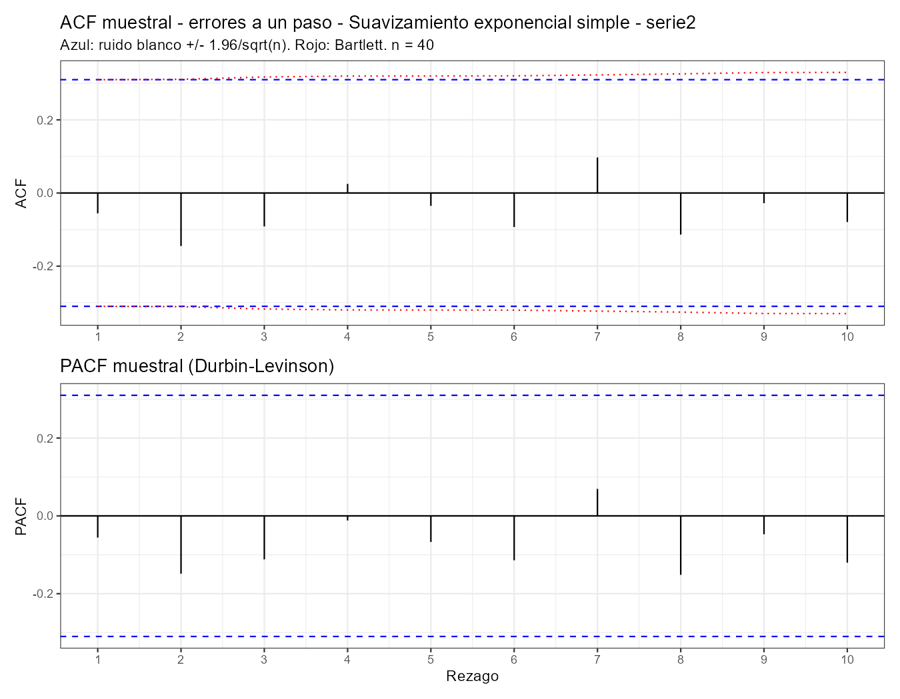{width=48%}

**Serie 3: Holt**

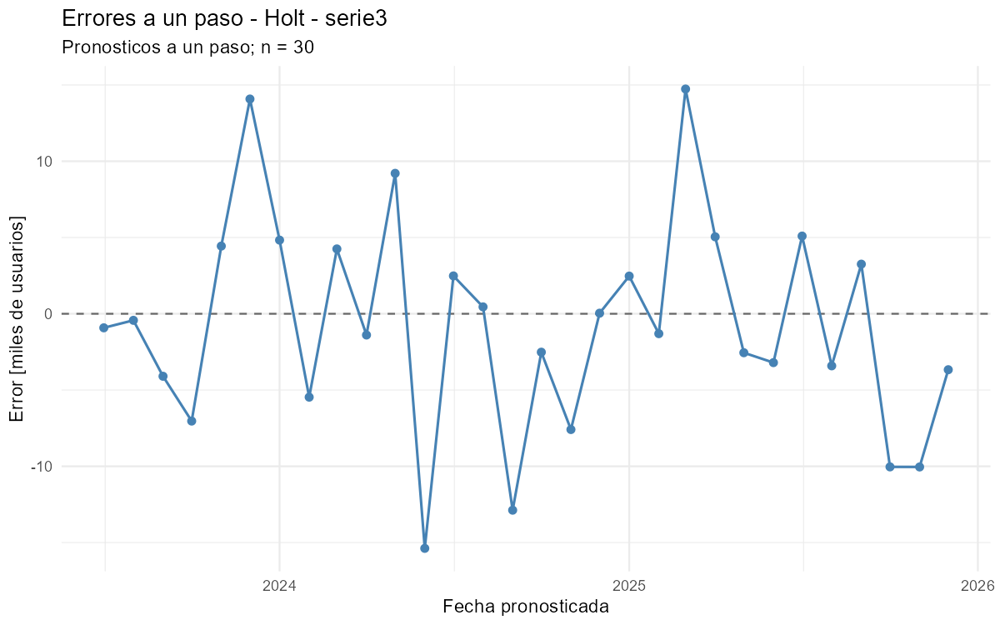{width=48%}
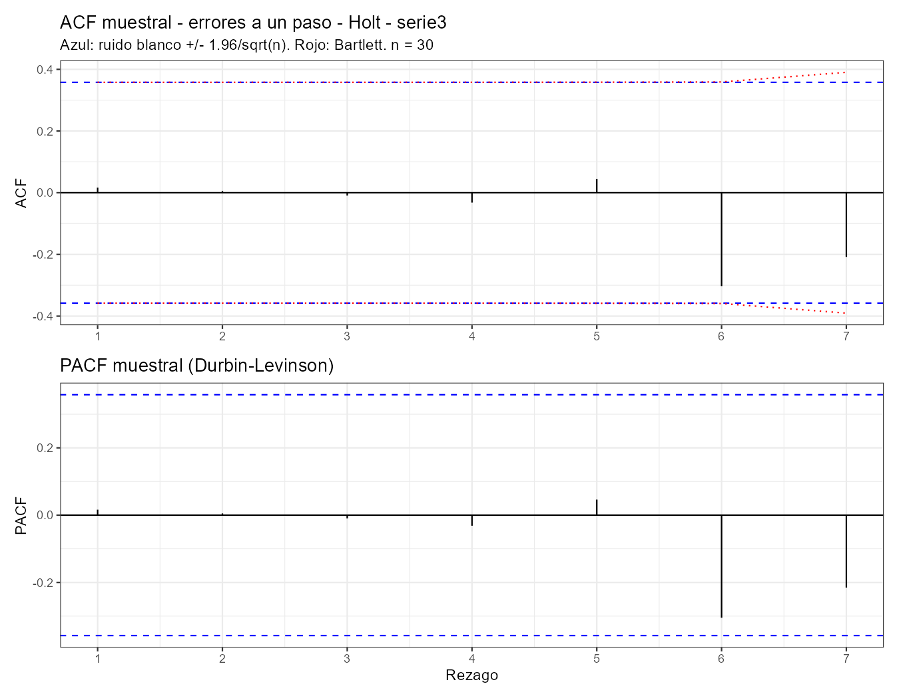{width=48%}

### Prueba t de media cero

Para cada ganador se contrasta
$$H_0:\mu_e=0\qquad\text{contra}\qquad H_1:\mu_e\ne0.$$
El estadístico es
$$t=\frac{\bar e}{s_e/\sqrt{n_e}}\sim t_{n_e-1}\quad\text{bajo }H_0.$$
Al 5 % se rechaza $H_0$ cuando $|t|>t_{0.975;n_e-1}$; el valor crítico se calcula para el tamaño de cada serie y aparece en la tabla junto al estadístico observado, el valor p y la decisión.

```{r}
#| label: media-cero-ganadores
#| echo: true
tabla_media_ganadores |>
  select(serie, metodo, n, media, error_estandar, t, gl,
         valor_critico, valor_p, decision) |>
  knitr::kable(
    col.names = c("Serie", "Ganador", "n", "Media", "EE", "t", "gl",
                  "Crítico", "Valor p", "Decisión"),
    digits = 4
  )
```

En ninguna serie se rechaza $H_0$: los valores p son `r vp(vg(tabla_media_ganadores, "serie1", "valor_p"))`, `r vp(vg(tabla_media_ganadores, "serie2", "valor_p"))` y `r vp(vg(tabla_media_ganadores, "serie3", "valor_p"))`. Por tanto, los errores no muestran sesgo medio estadísticamente detectable; esto significa que los ganadores no tienden sistemáticamente a pronosticar por encima o por debajo de lo observado.

### Prueba de Ljung-Box

Para cada ganador se contrasta
$$H_0:\rho_1=\cdots=\rho_m=0\qquad\text{contra}\qquad
H_1:\text{alguna }\rho_h\ne0.$$
Se usa $m=\min\{\lfloor n_e/4\rfloor,24\}$ y
$$Q_m=n_e(n_e+2)\sum_{h=1}^{m}\frac{r_h^2}{n_e-h}\sim\chi_m^2
\quad\text{bajo }H_0.$$
Los grados de libertad son $m$: no se descuentan parámetros porque se están examinando errores de pronóstico fuera de muestra. Al 5 % se rechaza cuando $Q_m>\chi^2_{0.95;m}$. La tabla incluye hipótesis mediante $m$, estadístico observado, distribución y grados de libertad, valor crítico, valor p y decisión; además registra los rezagos que cruzan individualmente la banda del correlograma.

```{r}
#| label: dependencia-ganadores
#| echo: true
tabla_dependencia_ganadores |>
  select(serie, metodo, n, m, banda, rezagos_fuera, Q, gl,
         valor_critico, valor_p, decision) |>
  knitr::kable(
    col.names = c("Serie", "Ganador", "n", "m", "Banda", "Rezagos fuera",
                  "Q", "gl", "Crítico", "Valor p", "Decisión"),
    digits = 4
  )
```

No se rechaza ausencia conjunta de autocorrelación en ninguna serie. En las series 2 y 3 ningún rezago cruza siquiera la banda individual. En la serie 1 aparece una señal aislada en el rezago 6, compatible con una oscilación semestral débil que la tendencia con efectos mensuales fijos no reproduce completamente; sin embargo, Ljung-Box queda apenas por debajo de la región de rechazo ($Q=`r f(vg(tabla_dependencia_ganadores, "serie1", "Q"), 3)`$ frente a `r f(vg(tabla_dependencia_ganadores, "serie1", "valor_critico"), 3)`$, valor p `r vp(vg(tabla_dependencia_ganadores, "serie1", "valor_p"))`), por lo que no se concluye que permanezca dependencia conjunta al 5 %.

### Prueba de Jarque-Bera

La normalidad se contrasta mediante
$$H_0:S=0\text{ y }K=3\qquad\text{contra}\qquad
H_1:S\ne0\text{ o }K\ne3,$$
con
$$JB=\frac{n_e}{6}\left[S^2+\frac{(K-3)^2}{4}\right]\sim\chi_2^2
\quad\text{bajo }H_0.$$
Al 5 % se rechaza cuando $JB>\chi^2_{0.95;2}=5.991$. La tabla presenta el estadístico observado, sus dos grados de libertad, valor crítico, valor p, decisión y las dos características muestrales que originan la prueba.

```{r}
#| label: normalidad-ganadores
#| echo: true
tabla_normalidad_ganadores |>
  select(serie, metodo, JB, gl, valor_critico, valor_p,
         decision, asimetria, curtosis) |>
  knitr::kable(
    col.names = c("Serie", "Ganador", "JB", "gl", "Crítico", "Valor p",
                  "Decisión", "Asimetría", "Curtosis"),
    digits = 4
  )
```

Jarque-Bera no rechaza normalidad para ninguno de los tres ganadores. Los errores son compatibles con asimetría cero y curtosis tres al 5 %, sin que “no rechazar” constituya una demostración de normalidad exacta.

### Durbin-Watson

Como diagnóstico adicional se calcula
$$d=\frac{\sum_{i=2}^{n_e}(e_i-e_{i-1})^2}{\sum_{i=1}^{n_e}e_i^2}
\approx2(1-r_1).$$
No se usa como una prueba separada: un valor próximo a 2 es compatible con ausencia de autocorrelación de primer orden, uno menor que 2 sugiere dependencia positiva y uno mayor que 2, negativa.

```{r}
#| label: dw-ganadores
#| echo: true
tabla_dw_ganadores |>
  select(serie, metodo, r1, DW, aproximacion_DW) |>
  knitr::kable(
    col.names = c("Serie", "Ganador", "r1", "DW", "2(1-r1)"),
    digits = 4
  )
```

SES y Holt presentan valores muy cercanos a 2, coherentes con sus correlogramas y con Ljung-Box. En la serie 1, $DW=`r f(vg(tabla_dw_ganadores, "serie1", "DW"), 3)`$ sugiere una dependencia negativa leve de primer orden, pero no suficiente para producir rechazo conjunto. En suma, los tres ganadores superan la validación exigida en $h=1$; la señal semestral aislada de la serie 1 debe conservarse como limitación del modelo.

## 6(e) Pronóstico final

Cada ganador se reajusta una sola vez con todas las observaciones de su serie, conservando los hiperparámetros elegidos exclusivamente en el tramo inicial. Desde el origen final $T$ se generan los $H$ pronósticos requeridos. Para cada horizonte $h$, la dispersión se estima con la desviación $s_h$ de los errores de origen móvil del ganador en ese mismo horizonte y se representa mediante
$$\hat y_{T+h\mid T}\pm1.96s_h.$$
Esta banda es **heurística**: resume la variabilidad empírica observada en la evaluación y cambia con el horizonte, pero no es un intervalo de confianza ni un intervalo probabilístico formal. En particular, no incorpora explícitamente incertidumbre de parámetros ni garantiza una cobertura del 95 %.

### Serie 1: demanda mensual de energía

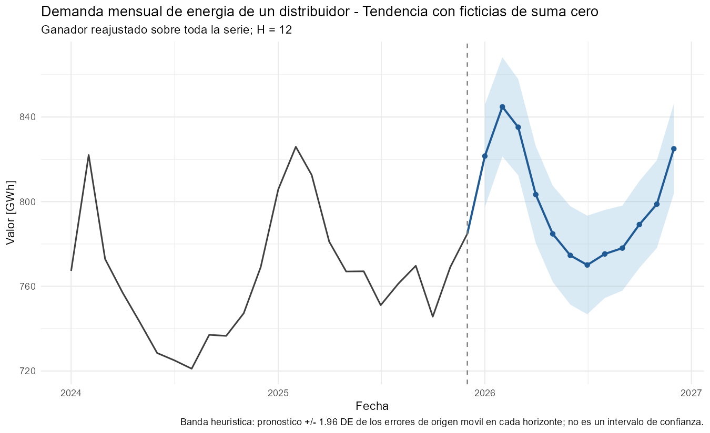{width=82%}

```{r}
#| label: pronostico-final-serie1
#| echo: true
tabla_pronosticos_finales |>
  filter(serie == "serie1") |>
  select(horizonte, fecha, pronostico, desviacion_error,
         limite_inferior, limite_superior) |>
  knitr::kable(
    col.names = c("h", "Fecha", "Pronóstico", "DE errores", "Límite inferior",
                  "Límite superior"),
    digits = 2
  )
```

La tendencia con ficticias conserva el perfil mensual: el máximo pronosticado es `r f(max(tabla_pronosticos_finales$pronostico[tabla_pronosticos_finales$serie == "serie1"]), 1)` GWh y el mínimo `r f(min(tabla_pronosticos_finales$pronostico[tabla_pronosticos_finales$serie == "serie1"]), 1)` GWh. La banda utiliza una desviación distinta para cada mes de 2026, estimada con los errores históricos del horizonte correspondiente.

### Serie 2: consumo diario de la estación de bombeo

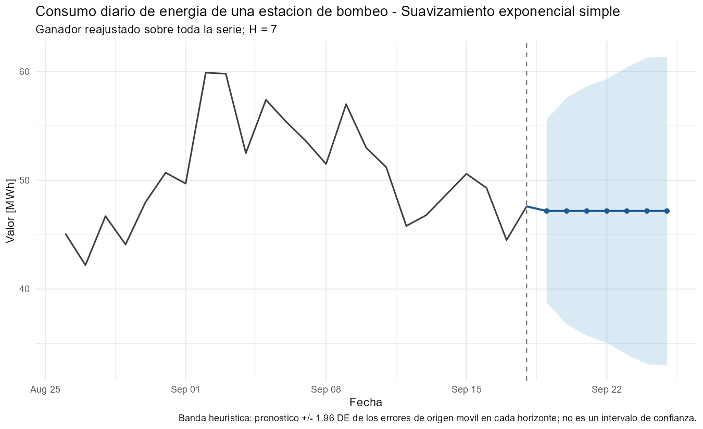{width=82%}

```{r}
#| label: pronostico-final-serie2
#| echo: true
tabla_pronosticos_finales |>
  filter(serie == "serie2") |>
  select(horizonte, fecha, pronostico, desviacion_error,
         limite_inferior, limite_superior) |>
  knitr::kable(
    col.names = c("h", "Fecha", "Pronóstico", "DE errores", "Límite inferior",
                  "Límite superior"),
    digits = 2
  )
```

SES produce un nivel constante de `r f(tabla_pronosticos_finales$pronostico[tabla_pronosticos_finales$serie == "serie2"][1], 2)` MWh para los siete días. Aunque el pronóstico puntual no cambia, la banda se ensancha con el horizonte porque la dispersión empírica de los errores aumenta de `r f(tabla_pronosticos_finales$desviacion_error[tabla_pronosticos_finales$serie == "serie2"][1], 2)` a `r f(tail(tabla_pronosticos_finales$desviacion_error[tabla_pronosticos_finales$serie == "serie2"], 1), 2)` MWh.

### Serie 3: usuarios conectados

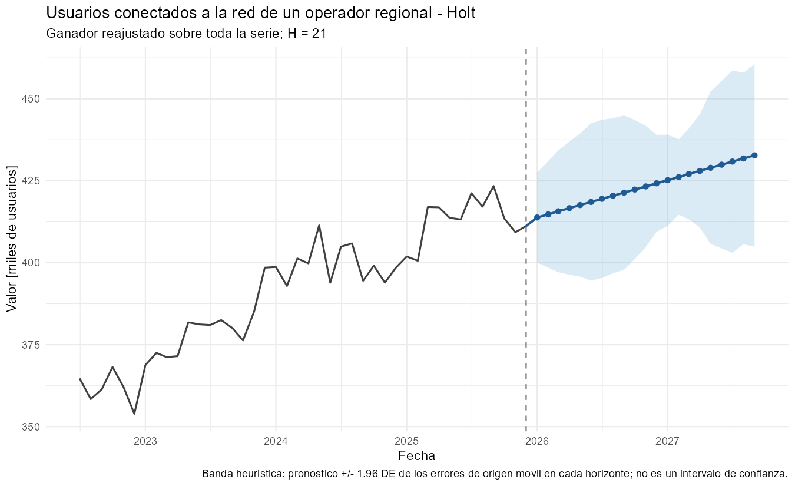{width=82%}

```{r}
#| label: pronostico-final-serie3
#| echo: true
tabla_pronosticos_finales |>
  filter(serie == "serie3") |>
  select(horizonte, fecha, pronostico, desviacion_error,
         limite_inferior, limite_superior) |>
  knitr::kable(
    col.names = c("h", "Fecha", "Pronóstico", "DE errores", "Límite inferior",
                  "Límite superior"),
    digits = 2
  )
```

Holt prolonga el crecimiento reciente desde `r f(tabla_pronosticos_finales$pronostico[tabla_pronosticos_finales$serie == "serie3"][1], 1)` hasta `r f(tail(tabla_pronosticos_finales$pronostico[tabla_pronosticos_finales$serie == "serie3"], 1), 1)` mil usuarios. La banda debe leerse únicamente como rango heurístico de error histórico. Con este ganador la trayectoria puntual no llega a 450 mil usuarios dentro de los 21 meses, aunque el límite superior de la banda lo supera desde el mes 17. La decisión sobre el transformador se toma en el punto 8 con el método de menor error a 21 meses, la tendencia cuadrática.


# 7. Conclusión técnica

Los resultados se sintetizan utilizando las transformaciones diagnosticadas en los puntos 4 y 5 y los errores de origen móvil del punto 6. En cada horizonte se comparan métodos evaluados sobre los mismos orígenes.

```{r}
#| label: resumen-conclusiones
#| echo: true
resumen_conclusiones <- tabla_origen_movil |>
  dplyr::group_by(serie, horizonte) |>
  dplyr::slice_min(RMSE, n = 1, with_ties = FALSE) |>
  dplyr::ungroup() |>
  dplyr::select(serie, horizonte, metodo, RMSE, rmse_referente, mejora_rmse_pct)
knitr::kable(resumen_conclusiones, digits = 2,
  col.names = c("Serie", "Horizonte", "Ganador", "RMSE", "RMSE referente", "Mejora (%)"))
```

## Serie 1. Demanda mensual de energía

La demanda mensual presenta tendencia creciente y estacionalidad anual aditiva ($s=12$; la correlación entre la media y la desviación de cada año es `r f(resultados$serie1$estacionalidad$evidencia$correlacion_media_desviacion, 3)`). La transformación $(1-B^{12})Y_t$ permite analizar diferencias entre meses equivalentes de años consecutivos y produce una serie plausiblemente estacionaria. A un paso, la tendencia con ficticias estacionales obtuvo el menor RMSE: **`r f(mejor_om("serie1", 1)$RMSE, 2)` GWh**, frente a **`r f(mejor_om("serie1", 1)$rmse_referente, 2)` GWh** del referente, una mejora del **`r f(mejor_om("serie1", 1)$mejora_rmse_pct, 2)` %**. Su pendiente estimada es aproximadamente **1.97 GWh por mes**, con efectos mensuales que permiten reflejar diferencias entre estaciones. Para doce meses, el mejor resultado corresponde a Holt-Winters aditivo, con $\alpha=\beta=\gamma=0.1$: RMSE de **`r f(mejor_om("serie1", 12)$RMSE, 2)` GWh**, frente a **`r f(mejor_om("serie1", 12)$rmse_referente, 2)` GWh**, una mejora del **`r f(mejor_om("serie1", 12)$mejora_rmse_pct, 2)` %**. Su actualización gradual de nivel, pendiente y estacionalidad es compatible con el patrón observado, aunque su ventaja queda establecida por la evaluación empírica. En los errores del ganador a un paso aparece una señal aislada en el rezago 6; la prueba conjunta de Ljung-Box no rechaza ausencia de autocorrelación al 5 % (valor p **`r f(vg(tabla_dependencia_ganadores, "serie1", "valor_p"), 4)`**), por lo que se interpreta como una limitación potencial y no como dependencia conjunta confirmada.

## Serie 2. Consumo diario de energía

El consumo fluctúa alrededor de un nivel estable de `r f(resultados$serie2$dependencia$media, 2)` MWh, sin tendencia ni estacionalidad semanal: las medias por día de la semana difieren a lo sumo `r f(resultados$serie2$estacionalidad$rango_medias, 2)` MWh, frente a una desviación de la serie de `r f(resultados$serie2$estacionalidad$desviacion_serie, 2)` MWh. Se conserva la serie sin diferenciar, porque $(1-B)$ solo reduce la varianza por efecto de $r_1 = `r f(resultados$serie2$transformacion$tabla$r1[1], 2)`$, no porque haya una tendencia que quitar. Para un día gana el suavizamiento exponencial simple (SES), con $\alpha=0.8$ y RMSE de **`r f(mejor_om("serie2", 1)$RMSE, 2)` MWh**, frente a **`r f(mejor_om("serie2", 1)$rmse_referente, 2)` MWh** del ingenuo, una mejora del **`r f(mejor_om("serie2", 1)$mejora_rmse_pct, 2)` %**. El valor alto de $\alpha$ da mayor peso a las observaciones recientes. Para siete días gana la media simple, sin parámetros, con RMSE de **`r f(mejor_om("serie2", 7)$RMSE, 2)` MWh**, frente a **`r f(mejor_om("serie2", 7)$rmse_referente, 2)` MWh**, una mejora del **`r f(mejor_om("serie2", 7)$mejora_rmse_pct, 2)` %**: al alargar el horizonte, el nivel promedio es una referencia más estable que el último valor. En los errores de SES a un paso no queda estructura: ningún rezago sale de la banda y la prueba de Ljung-Box no rechaza ausencia de autocorrelación (valor p **`r f(vg(tabla_dependencia_ganadores, "serie2", "valor_p"), 4)`**).

## Serie 3. Usuarios conectados a la red

El número de usuarios crece sostenidamente y sin estacionalidad anual: la amplitud de los índices estacionales (`r f(resultados$serie3$estacionalidad$amplitud_indices, 2)` mil) es menor que la desviación del residuo (`r f(resultados$serie3$estacionalidad$desviacion_residuo, 2)` mil). La transformación $(1-B)Y_t$ elimina la tendencia y deja incrementos mensuales plausiblemente estacionarios, con media de `r f(resultados$serie3$dependencia$media, 2)` mil usuarios por mes. A un mes gana Holt, con $\alpha=0.55$ y $\beta=0.05$, RMSE de **`r f(mejor_om("serie3", 1)$RMSE, 2)` miles de usuarios**, frente a **`r f(mejor_om("serie3", 1)$rmse_referente, 2)`**, una mejora del **`r f(mejor_om("serie3", 1)$mejora_rmse_pct, 2)` %**. A veintiún meses gana la tendencia cuadrática, con RMSE de **`r f(mejor_om("serie3", 21)$RMSE, 2)` miles de usuarios**, frente a **`r f(mejor_om("serie3", 21)$rmse_referente, 2)`**, una mejora del **`r f(mejor_om("serie3", 21)$mejora_rmse_pct, 2)` %**. La regresión cuadrática tiene coeficientes de 1.58 para $t$ y -0.000422 para $t^2$; este último no es significativo al 5 % con el error robusto, de modo que su elección para el horizonte largo se apoya en el error de pronóstico fuera del tramo de estimación y no en una curvatura demostrada. En los errores de Holt a un paso no queda estructura: ningún rezago sale de la banda y la prueba de Ljung-Box no rechaza ausencia de autocorrelación (valor p **`r f(vg(tabla_dependencia_ganadores, "serie3", "valor_p"), 4)`**).

## Comparación general

La demanda mensual requiere representar tendencia y estacionalidad: en ella ganaron la tendencia con ficticias a un mes (**`r f(mejor_om("serie1", 1)$RMSE, 2)` GWh**) y Holt-Winters aditivo a doce meses (**`r f(mejor_om("serie1", 12)$RMSE, 2)` GWh**). En la estación de bombeo, sin tendencia ni estación, SES gana a un día (**`r f(mejor_om("serie2", 1)$RMSE, 2)` MWh**) y la media simple a siete días (**`r f(mejor_om("serie2", 7)$RMSE, 2)` MWh**). Para los usuarios, Holt gana a un mes (**`r f(mejor_om("serie3", 1)$RMSE, 2)` miles**) y la tendencia cuadrática a veintiún meses (**`r f(mejor_om("serie3", 21)$RMSE, 2)` miles**). El ganador de una serie pierde en otra porque cada método supone una estructura distinta. La tendencia con ficticias gana en la serie 1, donde la estación existe, pero en la serie 3, aplicada como contraste, queda detrás del ingenuo a un paso (8.42 frente a 7.48 mil). Un pronóstico plano funciona en la serie 2, que no tiene tendencia, pero en la serie 3 acumula error con el horizonte: el ingenuo llega a un RMSE de 29.81 mil a veintiún meses. Y entre los métodos de tendencia importa cómo extrapolan: Holt gana a un mes en la serie 3, pero con $\beta=0.05$ su pendiente final es baja y a veintiún meses su RMSE sube a 14.09 mil, casi el doble del de la cuadrática; la tendencia exponencial, que supone crecimiento proporcional, es la peor de la serie (19.21 mil a un mes). Los RMSE de horizontes distintos no se comparan entre sí, porque provienen de orígenes distintos.

# 8. Argumentos para los interesados

Esta sección traduce los resultados estadísticos a las decisiones de contratación de energía y ampliación de infraestructura, con los costos descritos en el contexto del trabajo.

## 8(a) Mapa de interesados

### Serie 1. Demanda mensual de energía

La **gerencia comercial** determina cuántos GWh contratar por mes en 2026. La **junta directiva** aprueba la estrategia y asume su riesgo financiero. La **superintendencia** vigila los costos que pueden trasladarse a tarifas, mientras que los **usuarios** pueden verse afectados por esos sobrecostos. Un déficit de contratación se paga con un sobrecosto del **35 %** y un excedente se liquida con pérdida del **20 %** de su valor. El costo relativo de déficit es 1.75 veces el de excedente, por unidad comparable; sin un precio base por GWh no cabe calcular el valor absoluto en pesos.

### Serie 2. Consumo diario de energía

La **mesa de compras** contrata la energía para los siete días siguientes; el **jefe de operación** planifica la actividad de bombeo y la **gerencia financiera** administra el presupuesto. Los **usuarios de las tres veredas** dependen del servicio de agua, aunque no se puede cuantificar aquí un traslado del costo energético. Frente al precio contratado de 420 COP/kWh, comprar faltantes a 780 COP/kWh añade **360.000 COP/MWh**, mientras que vender sobrantes a 250 COP/kWh ocasiona una pérdida de **170.000 COP/MWh**. Por cada MWh de error, el déficit cuesta aproximadamente **2.12 veces** el excedente.

### Serie 3. Usuarios conectados

La **gerencia de planeación** decide cuándo ordenar el transformador; la **junta directiva** autoriza la inversión de **6.800 millones de COP**, y el **área de operación** organiza su instalación. Los **usuarios** dependen de la continuidad del servicio y el **regulador** puede intervenir ante incumplimientos. Una compra prematura inmoviliza capital, pero una compra tardía puede dejar la red por encima de los **450 mil usuarios** durante los **nueve meses** que tarda la instalación. El contexto no cuantifica en pesos las interrupciones ni las posibles sanciones.

## 8(b) Argumentos para los interesados

### Serie 1. Demanda mensual de energía

**Afirmación.** Contratar cantidades diferentes para cada mes de 2026, prestando particular atención al riesgo de déficit.

**Evidencia.** Holt-Winters aditivo obtuvo RMSE de **`r f(mejor_om("serie1", 12)$RMSE, 2)` GWh** a doce meses frente a **`r f(mejor_om("serie1", 12)$rmse_referente, 2)` GWh** del referente, una reducción del **`r f(mejor_om("serie1", 12)$mejora_rmse_pct, 2)` %**. Sus cantidades estimadas para 2026 van aproximadamente de **771 a 845 GWh por mes**, como muestra la nota de interesados.

**Justificación.** Un contrato uniforme ignoraría el patrón anual. Además, un faltante cuesta el 35 % adicional y un excedente pierde el 20 % de su valor: los costos de equivocarse en cada dirección son distintos.

**Alcance.** Esta recomendación corresponde a 2026 bajo un patrón de demanda comparable al histórico. El pronóstico es una referencia y no determina, por sí solo, la contratación de costo mínimo.

**Objeción.** ¿Por qué no elegir el ganador a un mes? La tendencia con ficticias obtuvo **`r f(mejor_om("serie1", 1)$RMSE, 2)` GWh** a un paso; sin embargo, para contratar todo el año importa la evaluación a doce meses, donde Holt-Winters obtuvo **`r f(mejor_om("serie1", 12)$RMSE, 2)` GWh**. Son comparaciones dentro de horizontes distintos.

### Serie 2. Consumo diario de energía

**Afirmación.** Usar el promedio de consumo como referencia para contratar los siete días siguientes y vigilar los déficits, porque son más costosos.

**Evidencia.** La media simple obtuvo a siete días RMSE de **`r f(mejor_om("serie2", 7)$RMSE, 2)` MWh**, frente a **`r f(mejor_om("serie2", 7)$rmse_referente, 2)` MWh** del referente, una mejora del **`r f(mejor_om("serie2", 7)$mejora_rmse_pct, 2)` %**. El pronóstico para el período 19–25 de septiembre de 2025 es aproximadamente **47.7 MWh diarios**.

**Justificación.** La serie fluctúa alrededor de un nivel estable. Por cada 5 MWh faltantes, el costo adicional sería **1.800.000 COP**, frente a **850.000 COP** de pérdida por 5 MWh sobrantes. Minimizar RMSE no equivale necesariamente a minimizar el costo de compras.

**Alcance.** La referencia corresponde a la semana que sigue al último dato; debe actualizarse ante cambios de operación o de consumo. No representa por sí misma una cantidad económicamente óptima.

**Objeción.** ¿Por qué la media simple y no SES? SES ganó a un día (**`r f(mejor_om("serie2", 1)$RMSE, 2)` MWh**), pero para el horizonte de siete días la media simple consiguió el menor error (**`r f(mejor_om("serie2", 7)$RMSE, 2)` MWh**).

### Serie 3. Usuarios conectados a la red

**Afirmación.** Revisar durante 2026 la autorización del transformador para no esperar a superar los 450 mil usuarios antes de solicitarlo.

**Evidencia.** La tendencia cuadrática obtuvo a veintiún meses RMSE de **`r f(mejor_om("serie3", 21)$RMSE, 2)` miles de usuarios**, frente a **`r f(mejor_om("serie3", 21)$rmse_referente, 2)`** del referente, una mejora del **`r f(mejor_om("serie3", 21)$mejora_rmse_pct, 2)` %**. La trayectoria puntual alcanza los **450 mil usuarios en septiembre de 2027**; restando nueve meses, la orden orientativa sería en **diciembre de 2026**.

**Justificación.** Esperar a alcanzar el umbral dejaría nueve meses sin capacidad nueva. La ampliación cuesta 6.800 millones de COP; las consecuencias monetarias del retraso no se pueden precisar con el contexto disponible.

**Alcance.** El resultado depende de que continúe una dinámica de crecimiento semejante a la observada. La fecha de cruce es una estimación puntual, no una garantía ni una probabilidad de sobrecarga.

**Objeción.** ¿Por qué utilizar la tendencia cuadrática si su curvatura no es significativa? Porque el criterio para la decisión fue el error de pronóstico a veintiún meses (**`r f(mejor_om("serie3", 21)$RMSE, 2)` miles**), no la significancia aislada de un coeficiente. La incertidumbre sobre el mes exacto exige revisar la proyección periódicamente.

## 8(c) Nota para los interesados

Se elaboró una nota independiente de **una página**, dirigida a las personas que toman y ejecutan las decisiones y a quienes resultan afectados. Presenta un gráfico por serie, las cantidades de referencia, los costos de equivocarse por exceso o defecto y los límites de las proyecciones, sin fórmulas ni lenguaje técnico del curso.

**Documento de entrega:** [Ver nota para los interesados (PDF)](nota-interesados.pdf).

Los gráficos se elaboraron con los métodos que obtuvieron el menor RMSE en el horizonte correspondiente a cada decisión, distintos en algunos casos de los ganadores a un paso utilizados en el punto 6(e).

# Bloques de verificación

```{r}
#| label: verificacion
#| comment: ""
inicio <- grep(">>> BLOQUES DE VERIFICACION", salida)[1]
cat(salida[inicio:length(salida)], sep = "\n")
```

