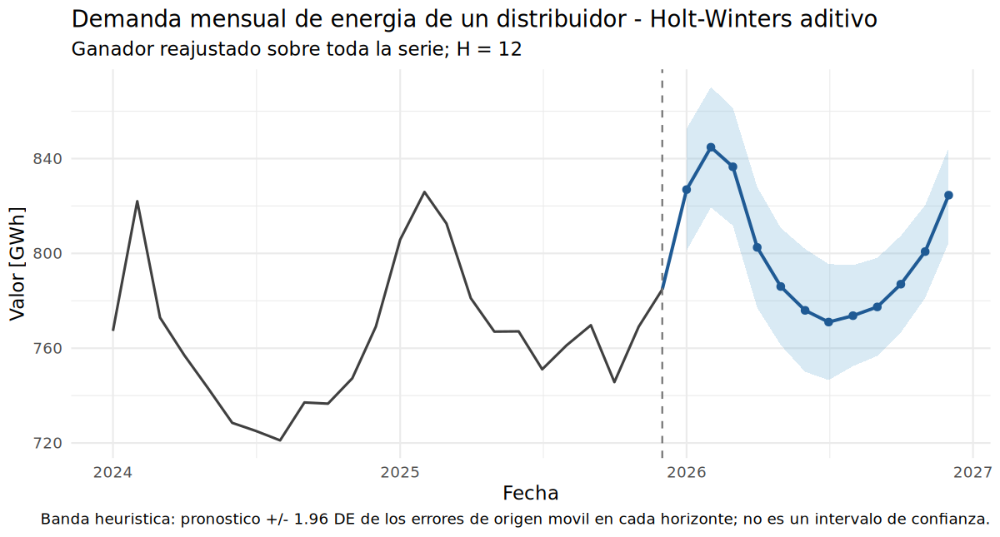
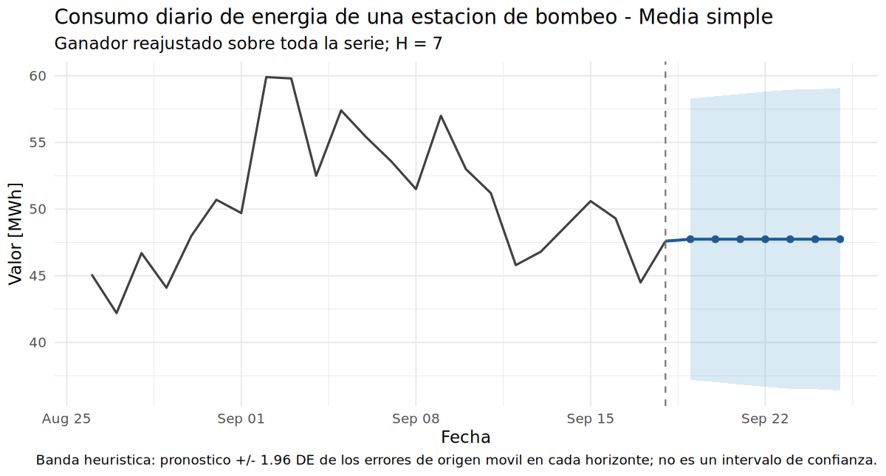
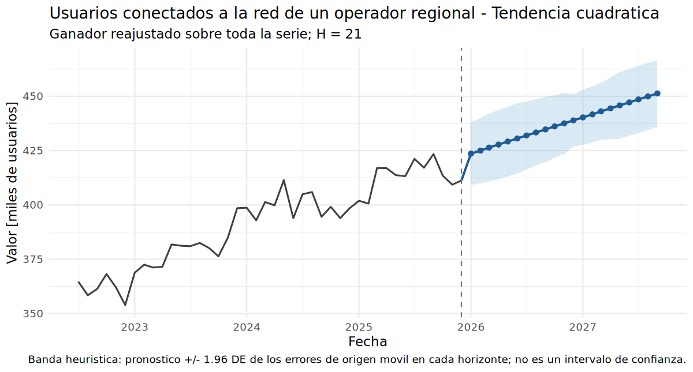

## Contratación de energía para 2026

**Recomendación.** Contratar cantidades distintas por mes, tomando como referencia una demanda prevista entre **771 y 845 GWh**. Los valores mensuales exactos están en el archivo de apoyo del equipo. En la evaluación histórica, el error de pronóstico a doce meses fue de **10,09 GWh**. Una compra insuficiente implica un sobrecosto del **35 %**; el excedente genera una pérdida del **20 %**. La cantidad definitiva debe considerar estos riesgos, no solo la cifra prevista.

{fig-alt="Demanda mensual prevista para 2026"}

## Compra de energía para la estación de bombeo

**Recomendación.** Para los siete días posteriores al último dato disponible (**19–25 de septiembre de 2025**), usar como referencia **47,7 MWh por día**, aproximadamente **333,9 MWh en la semana**. En la evaluación, el error a siete días fue de **5,77 MWh**. Cada MWh faltante cuesta **360.000 COP adicionales** y cada MWh sobrante ocasiona una pérdida de **170.000 COP**. Estas fechas corresponden a la serie estudiada, no a la semana actual.

{fig-alt="Consumo diario previsto para los siete días siguientes al fin de la serie"}

## Ampliación de la red de distribución

**Recomendación.** Revisar durante **2026** la autorización del nuevo transformador. La proyección alcanza el límite de **450 mil usuarios en septiembre de 2027**; para disponer del equipo a tiempo, la **orden orientativa sería en diciembre de 2026**. La inversión asciende a **6.800 millones de COP** y la instalación tarda nueve meses. El error observado al horizonte de evaluación fue de **7,53 mil usuarios**, por lo que la fecha debe revisarse antes de comprometer la inversión.

{fig-alt="Usuarios conectados previstos y capacidad actual"}

**Límite de estas recomendaciones.** Son estimaciones construidas con información histórica y no garantizan consumos exactos ni una fecha cierta de sobrecarga. Cambios en demanda, operación y crecimiento regional pueden requerir ajustes.
